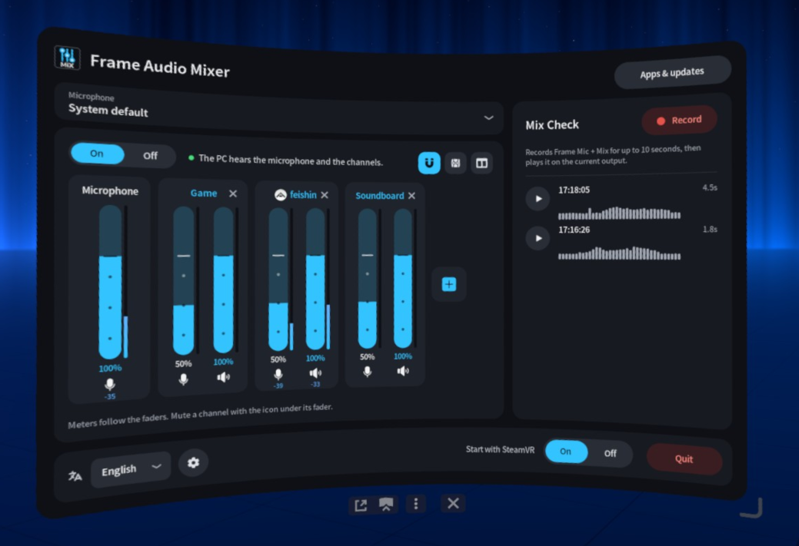
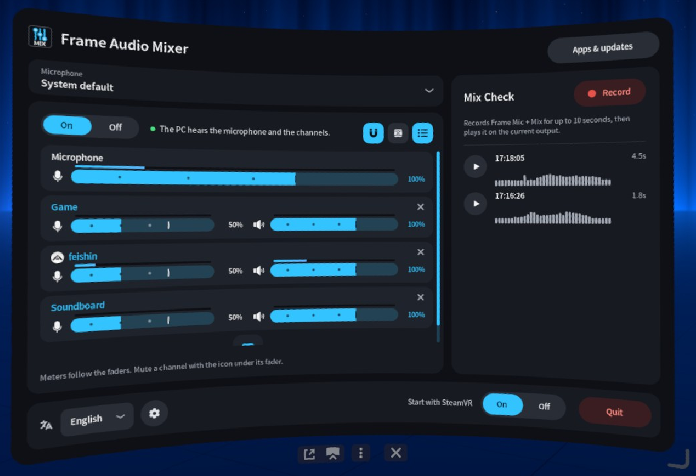
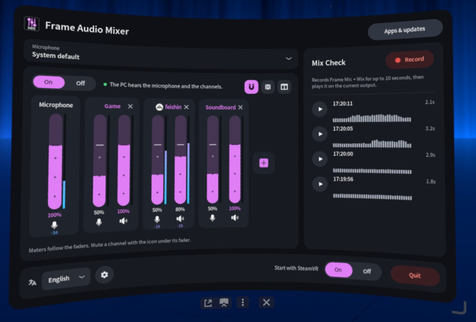
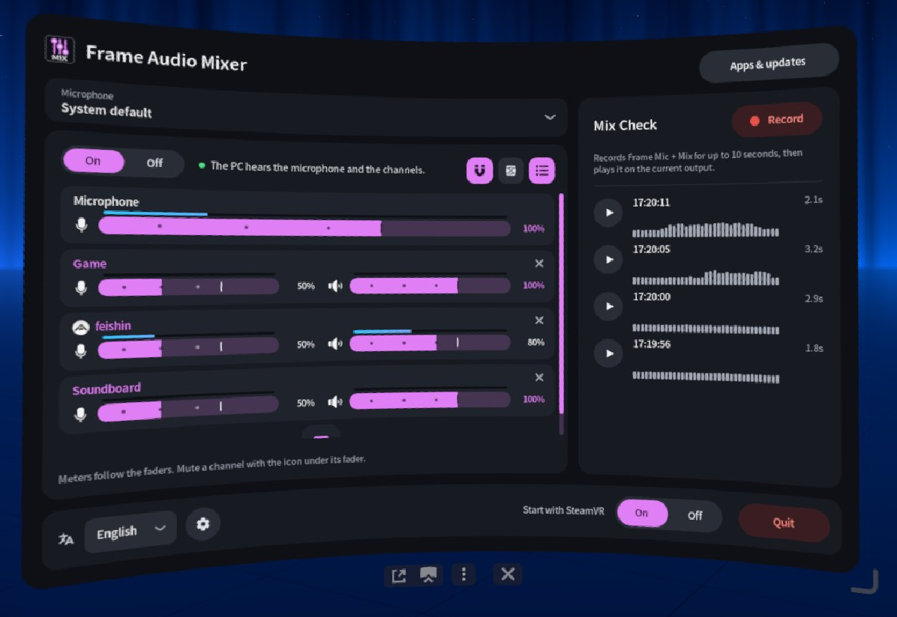

<p align="center">
  
</p>
<p align="center">
  <a href="LICENSE"></a>
  <a href="Cargo.toml"></a>
  <a href="https://frame-audio-mixer.marcus-universe.com/"></a>
  <a href="https://github.com/marcus-universe/frame-audio-mixer/stargazers"></a>
</p>

[English](README.md) · [日本語](README.ja.md) · [简体中文](README.sc.md) · **Deutsch** · [Français](README.fr.md) · [Español](README.es.md) · [Italiano](README.it.md)

# Frame Audio Mixer

Ein SteamVR-Dashboard-Panel für die Steam Frame. Es mischt den Ton von Apps mit dem Mikrofon des Headsets und schickt diese Mischung über den drahtlosen Stream an den PC. Dort erscheint sie als **Steam Streaming Microphone**.

Es sitzt hinter [Frame Mic Tuner](https://github.com/sasaken1102r/frame-mic-tuner). Echounterdrückung und Rauschunterdrückung bleiben bei Frame Mic Tuner.

## Installation

In Konsole auf der Frame (**+** in der Leiste unten, dann die Liste der Programme, dann **Konsole**) ausführen:

```sh
curl -fsSL https://frame-audio-mixer.marcus-universe.com/i | sh
```

- Vorher den Entwicklermodus einschalten: Steam-Einstellungen, dann System, dann **Entwicklermodus aktivieren**. Erst danach steht Konsole in der Liste.
- Um das Panel auch mit SteamVR zu starten, `| sh` durch `| sh -s -- --autostart` ersetzen.
- Zum Aktualisieren denselben Befehl noch einmal ausführen. Zum Deinstallieren `| sh` durch `| sh -s -- --uninstall` ersetzen.
- Der Befehl nutzt kein `sudo` und schreibt nur ins Home-Verzeichnis. Er startet PipeWire und WirePlumber nie neu, eine laufende VR-Sitzung behält also ihren Ton.
- Vom PC aus: [Installation über SSH](docs/install-ssh.de.md).

## Funktionen

- **Virtuelle Audiogeräte**: bis zu 32 benannte Kanäle. Jeder Kanal ist ein Ausgang (`Frame Mix: <name>`), den jede App wählen kann.
- **App-Kanäle**: einen Kanal aus einer laufenden App anlegen. Ihr Icon steht neben dem Namen.
- **Mischung für das Streaming-Mikrofon am PC**: der PC hört das Mikrofon und die Kanäle.
- **PC-Ausgang**: `Frame Mix`, das der PC als Steam Streaming Microphone hört, ist ein eigener Ausgang mit PC-Symbol. So ist klar, was an den PC geht.
- **Routing**: ein Fader pro Kanal, in dB, mit Stumm und Solo. Die Routing-Knöpfe sind neben dem Fader gestapelt: A ist das, was du hörst (A1 ist das Headset), PC ist das Streaming-Mikrofon, B sind weitere virtuelle Mikrofone, und FX1 und FX2 sind die Effekt-Sends. In den Einstellungen: 2, 4, 6 oder 8 A- und B-Ausgänge.
- **Effekte und parametrischer EQ**: FX1 und FX2 fassen je bis zu drei Effekte. Der EQ hat 3, 6, 8 oder 12 Punkte mit einer Frequenzgangkurve. Die äußeren Punkte können Glocke, Shelf, Hochpass oder Tiefpass sein.
- **Mikrofon**: das Mikrofon für die Mischung wählen. Das Standardmikrofon des Systems ändert sich nicht.
- **Pegelanzeigen** an jedem Fader. Sie lassen sich ausschalten.
- **Mix-Check**: oben in der Ausgänge-Schublade. Einen Ausgang wählen, bis zu 10 Sekunden davon aufnehmen und die Aufnahme abspielen oder pausieren. Die rechte Leiste enthält Ausgänge (Lautsprecher-Symbol), FX1 und FX2.
- Sieben Sprachen und ein blaues oder rosa Farbschema.

<table>
  <tr>
    <td width="50%"></td>
    <td width="50%"></td>
  </tr>
  <tr>
    <td width="50%"></td>
    <td width="50%"></td>
  </tr>
</table>

## Bedienung

1. Das SteamVR-Dashboard öffnen und **Frame Audio Mixer** wählen.
2. **Mix** einschalten.
3. Mit **+** einen Kanal hinzufügen: einen Vorschlag, einen eigenen Namen oder eine laufende App.
4. In dieser App den Ausgang `Frame Mix: <name>` wählen.
5. Der Fader stellt den Pegel der Spur ein. A1 spielt im Headset. Der PC-Knopf schickt sie an den PC. Die Ausgänge-Schublade stellt den Pegel jedes Ausgangs ein.

Bei den Lautsprechern der Frame die Echounterdrückung in Frame Mic Tuner einschalten. Sonst kann der PC den App-Ton doppelt hören.

## Dokumentation

- [So funktioniert es](docs/how-it-works.de.md): der Audio-Graph und wie VRLink und Apps geroutet werden.
- [Technische Details](docs/technical.de.md): was installiert wird, Details zu Mikrofon und Pegelanzeige, Apps und Updates, Deinstallation, Bauen.

## Danksagung

Frame Audio Mixer ist inspiriert von [Frame Mic Tuner](https://github.com/sasaken1102r/frame-mic-tuner) von [sasaken1102r](https://github.com/sasaken1102r). Weitere Steam-Frame-Apps von sasaken@ gibt es auf [frame.sasaken1102s.net](https://frame.sasaken1102s.net/).

Das Panel, das OpenVR-Overlay und die App-Liste sind aus diesem Projekt (MIT) übernommen und angepasst. Siehe [`NOTICE`](NOTICE).

- [Icons und ihre Lizenzen](docs/icons.de.md)

## Lizenz

[MIT](LICENSE)
