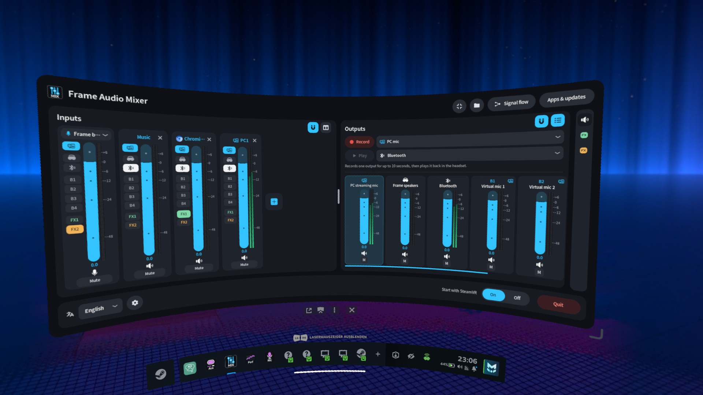
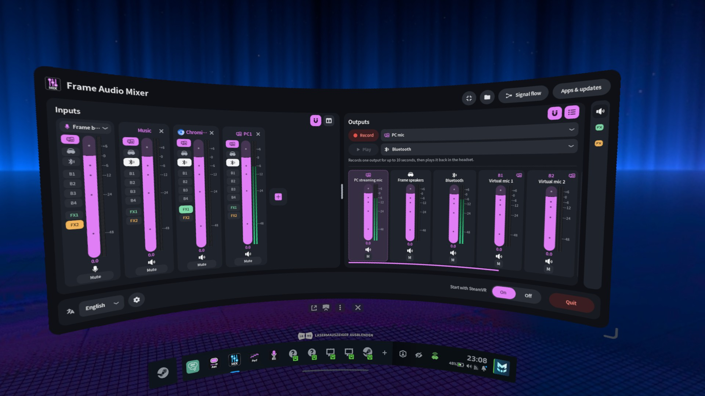
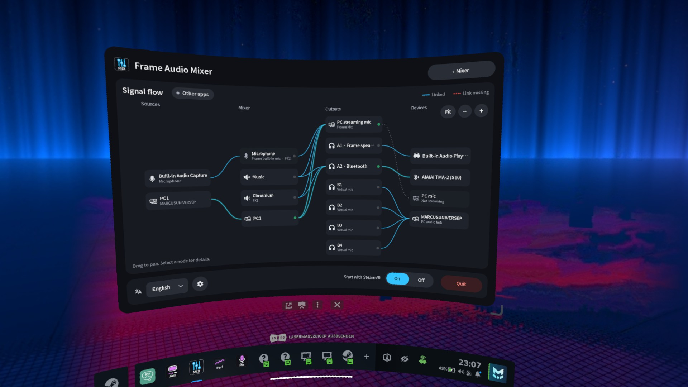
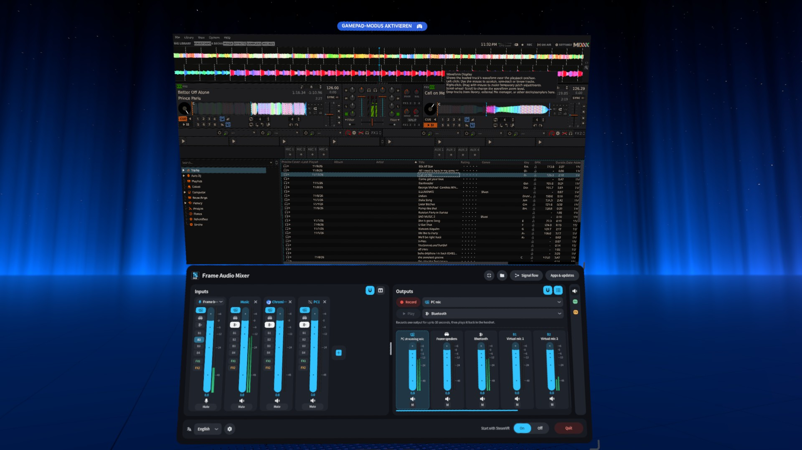

<p align="center">
  <a href="https://frame-audio-mixer.marcus-universe.com/"></a>
</p>
<p align="center">
  <a href="LICENSE"></a>
  <a href="Cargo.toml"></a>
  <a href="https://frame-audio-mixer.marcus-universe.com/"></a>
  <a href="https://github.com/marcus-universe/frame-audio-mixer/stargazers"></a>
</p>

[English](README.md) · [日本語](README.ja.md) · [简体中文](README.sc.md) · [Deutsch](README.de.md) · **Français** · [Español](README.es.md) · [Italiano](README.it.md)

# 🎚️ Frame Audio Mixer

Frame Audio Mixer vous permet de créer plusieurs canaux audio et plusieurs mix sur le Steam Frame. Combinez le son des applis avec le micro du casque, puis envoyez chaque mix là où vous en avez besoin : sur les haut-parleurs du Frame ou un casque audio dans le casque VR, ou au PC par le flux sans fil, où il arrive comme le **Steam Streaming Microphone** que SteamVR fournit déjà.

Il se place après [Frame Mic Tuner](https://github.com/sasaken1102r/frame-mic-tuner), qui gère toujours l'annulation d'écho et la réduction de bruit.

## 📥 Installation

Dans Konsole sur le Frame (**+** dans la barre en bas, puis la liste des programmes, puis **Konsole**), lancez :

```sh
curl -fsSL https://frame-audio-mixer.marcus-universe.com/i | sh
```

- 🛠️ Activez d'abord le mode développeur : Paramètres Steam, puis Système, puis **Activer le mode développeur**. Konsole n'apparaît pas dans la liste avant cela.
- 💻 Depuis un PC : [Installation par SSH](docs/install-ssh.fr.md).
- 🖥️ Périphériques audio du PC (Steam Streaming Mic B1–B4 et Out PC1–PC4, Windows et Linux) : [Installer sur le PC](docs/install-pc.fr.md).

## ✨ Fonctionnalités

- 🧩 **Canaux logiciels** : ajoutez jusqu'à 32 applis comme entrées. Choisissez une appli déjà lancée, ou créez une sortie virtuelle nommée que n'importe quelle appli du Steam Frame peut sélectionner. Son son arrive alors dans le mixeur sur son propre canal.
- 🎤 **Micros virtuels** : B1 à B4, nommés, en plus du micro de streaming du PC.
- 🔗 **Lien audio PC** : avec le module Frame Audio Link pour SteamVR, B1 à B4 sont aussi quatre micros sur le PC, et quatre sorties du PC (PC1 à PC4) peuvent être ajoutées comme canaux. Chaque flux peut être coupé pour économiser la bande passante.
- 🎧 **Haut-parleurs, Bluetooth et USB** : le mix sort sur les haut-parleurs du Frame, un casque Bluetooth ou l'audio USB tant que l'un est connecté.
- 🎛️ **Bus d'effets** : FX1 et FX2, avec réverbération, compresseur, EQ, pitch, flanger et phaser. Chaque tranche peut activer l'un ou l'autre ; le résultat remplace le son de la tranche sur ses propres sorties.
- 🗂️ **Projets** : enregistrez les canaux, le routage, les effets et les niveaux sous un nom, et rechargez une configuration à tout moment.
- 🗺️ **Flux du signal** : une carte en direct du routage complet. Chaque route est vérifiée contre les liens PipeWire réels ; un lien rompu apparaît en pointillés rouges. Glisser pour déplacer, sélectionner un nœud pour son identité PipeWire.
- 📊 **Niveaux, sourdine et accroche** : la même échelle sur chaque fader, de +6 à −48, un bouton de sourdine sous chacun, et des faders de sortie qui s'accrochent aux repères.
- ⏺️ **Contrôle du mix** : en haut des sorties. Choisir une sortie, en enregistrer jusqu'à 10 secondes, puis lire ou mettre en pause.
- 🔄 **Orientation** : les entrées et les sorties passent chacune des faders verticaux aux rangées.
- 🌐 Sept langues, et un thème bleu ou rose.

<table>
  <tr>
    <td width="50%"></td>
    <td width="50%"></td>
  </tr>
  <tr>
    <td width="50%"></td>
    <td width="50%"></td>
  </tr>
</table>

## ▶️ Utilisation

1. Ouvrez le tableau de bord SteamVR et choisissez **Frame Audio Mixer**.
2. Activez le mix. Le PC l'entend comme **Steam Streaming Microphone**.
3. Appuyez sur **+** et ajoutez un canal. Donnez-lui un nom, ou choisissez une appli déjà lancée.
4. Dans cette appli, choisissez la sortie qui porte le nom du canal.
5. **Entrées**, à gauche, est ce qui entre dans le mix. **Sorties**, à droite, est la destination : le PC, les haut-parleurs du Frame, le Bluetooth, l'USB, ou un micro virtuel.

🎧 Si vous écoutez sur les haut-parleurs du Frame, activez l'annulation d'écho dans Frame Mic Tuner. Sinon le PC peut entendre ce son deux fois.

## 📚 Documentation

- 📖 [Fonctionnement](docs/how-it-works.fr.md) : le graphe audio, et le routage de VRLink et des applis.
- 🔧 [Détails techniques](docs/technical.fr.md) : ce qui est installé, détails sur le micro et les indicateurs de niveau, applis et mises à jour, désinstallation, compilation.
- 🔗 [Lien audio PC](docs/pc-link.md) (en anglais) : le module SteamVR pour le PC, son installation, son utilisation et le comportement du lien.

## 🙏 Crédits

Frame Audio Mixer s'inspire de [Frame Mic Tuner](https://github.com/sasaken1102r/frame-mic-tuner) de [sasaken1102r](https://github.com/sasaken1102r). D'autres applis Steam Frame de sasaken@ sont sur [frame.sasaken1102s.net](https://frame.sasaken1102s.net/).

Le panneau, l'overlay OpenVR et la liste des applis sont adaptés de ce projet (MIT). Voir [`NOTICE`](NOTICE).

- 🎨 [Icônes et leurs licences](docs/icons.fr.md)

## 📄 Licence

[MIT](LICENSE)
