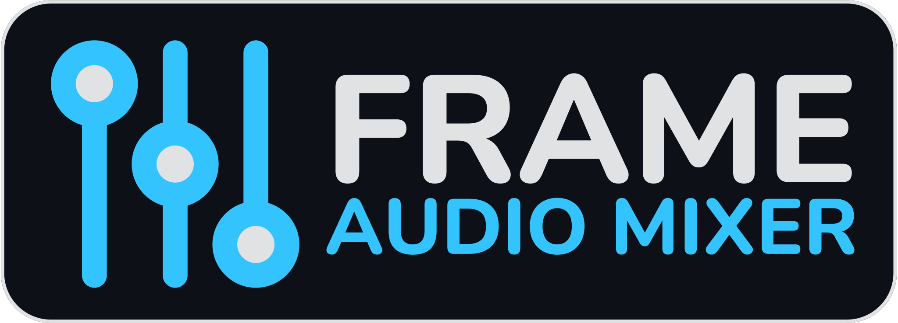
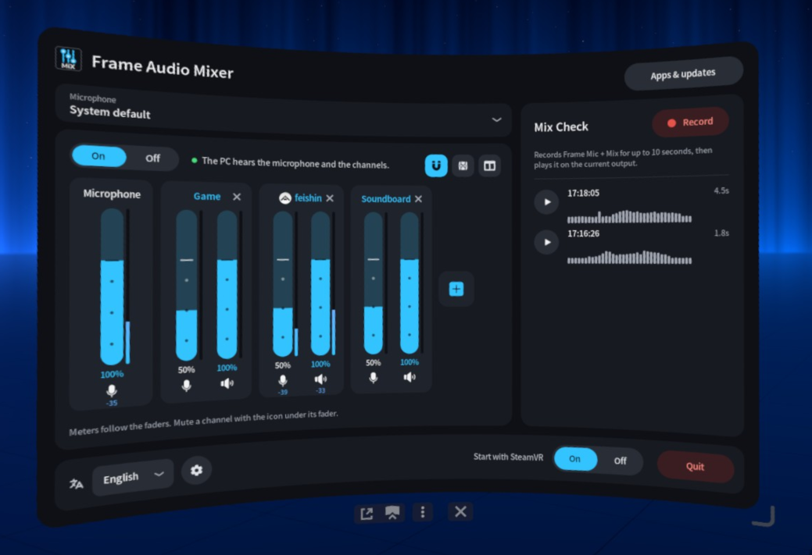
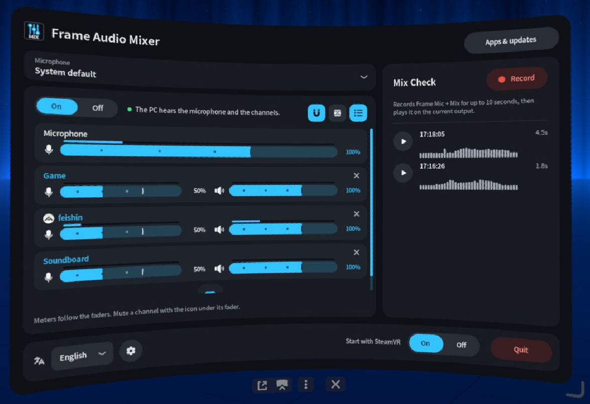
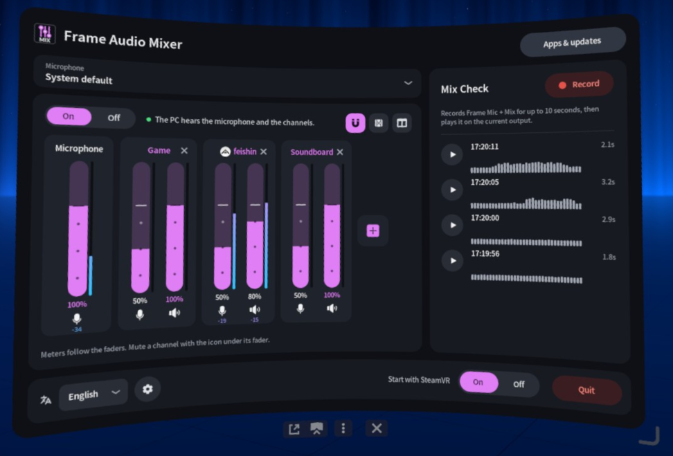
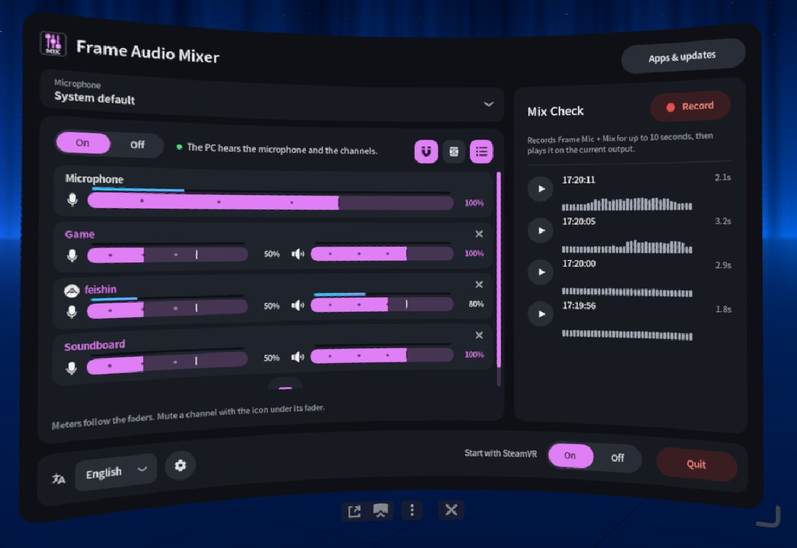

<p align="center">
  
</p>
<p align="center">
  <a href="LICENSE"></a>
  <a href="Cargo.toml"></a>
  <a href="https://frame-audio-mixer.marcus-universe.com/"></a>
  <a href="https://github.com/marcus-universe/frame-audio-mixer/stargazers"></a>
</p>

[English](README.md) · [日本語](README.ja.md) · [简体中文](README.sc.md) · [Deutsch](README.de.md) · **Français** · [Español](README.es.md) · [Italiano](README.it.md)

# Frame Audio Mixer

Un panneau du tableau de bord SteamVR pour le Steam Frame. Il mélange le son des applis avec le micro du casque et envoie ce mix au PC par le flux sans fil. Sur le PC, il apparaît sous le nom **Steam Streaming Microphone**.

Il se place après [Frame Mic Tuner](https://github.com/sasaken1102r/frame-mic-tuner), qui gère toujours l'annulation d'écho et la réduction de bruit.

## Installation

Dans Konsole sur le Frame (**+** dans la barre en bas, puis la liste des programmes, puis **Konsole**), lancez :

```sh
curl -fsSL https://frame-audio-mixer.marcus-universe.com/frame-audio-mixer-install | sh
```

- Activez d'abord le mode développeur : Paramètres Steam, puis Système, puis **Activer le mode développeur**. Konsole n'apparaît pas dans la liste avant cela.
- Pour démarrer aussi le panneau avec SteamVR, terminez la commande par `| sh -s -- --autostart`.
- Pour mettre à jour, relancez la même commande. Pour désinstaller, terminez-la par `| sh -s -- --uninstall`.
- L'installation n'utilise pas `sudo` et n'écrit que dans votre répertoire personnel. Elle ne redémarre jamais PipeWire ni WirePlumber, donc une session VR en cours garde son son.
- Depuis un PC : [Installation par SSH](docs/install-ssh.fr.md).

## Fonctionnalités

- **Appareils audio virtuels** : jusqu'à 32 canaux nommés. Chacun est une sortie (`Frame Mix: <name>`) que n'importe quelle appli peut choisir.
- **Canaux d'appli** : créez un canal à partir d'une appli en cours. Son icône s'affiche à côté du nom.
- **Mix pour le micro de streaming du PC** : le PC entend votre micro et les canaux.
- **Deux faders par canal** : un pour le casque, un pour le PC, chacun avec sa propre sourdine. Les faders s'aimantent à 20, 50, 80 et 100 %.
- **Microphone** : choisissez le micro du mix. Le micro par défaut du système ne change pas.
- **Indicateurs de niveau** sur chaque fader. Vous pouvez les désactiver.
- **Contrôle du mix** : enregistrez jusqu'à 10 secondes de ce que le PC entend, puis réécoutez-les.
- Sept langues, et un thème de couleur bleu ou rose.

<table>
  <tr>
    <td width="50%"></td>
    <td width="50%"></td>
  </tr>
  <tr>
    <td width="50%"></td>
    <td width="50%"></td>
  </tr>
</table>

## Utilisation

1. Ouvrez le tableau de bord SteamVR et choisissez **Frame Audio Mixer**.
2. Activez **Mix**.
3. Appuyez sur **+** pour ajouter un canal : une suggestion, votre propre nom ou une appli en cours.
4. Dans cette appli, choisissez la sortie `Frame Mix: <name>`.
5. Le fader haut-parleur règle le volume du canal dans votre casque. Le fader micro règle la part que le PC en entend.

Si vous utilisez les haut-parleurs du Frame, activez l'annulation d'écho dans Frame Mic Tuner. Sinon, le PC peut entendre le son de l'appli deux fois.

## Documentation

- [Fonctionnement](docs/how-it-works.fr.md) : le graphe audio, et le routage de VRLink et des applis.
- [Détails techniques](docs/technical.fr.md) : ce qui est installé, détails sur le micro et les indicateurs de niveau, applis et mises à jour, désinstallation, compilation.

## Crédits

Frame Audio Mixer s'inspire de [Frame Mic Tuner](https://github.com/sasaken1102r/frame-mic-tuner) de [sasaken1102r](https://github.com/sasaken1102r). D'autres applis Steam Frame de sasaken@ sont sur [frame.sasaken1102s.net](https://frame.sasaken1102s.net/).

Le panneau, l'overlay OpenVR et la liste des applis sont adaptés de ce projet (MIT). Voir [`NOTICE`](NOTICE).

- [Icônes et leurs licences](docs/icons.fr.md)

## Licence

[MIT](LICENSE)
