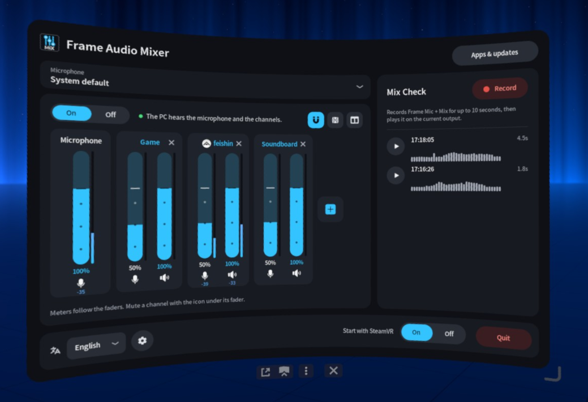
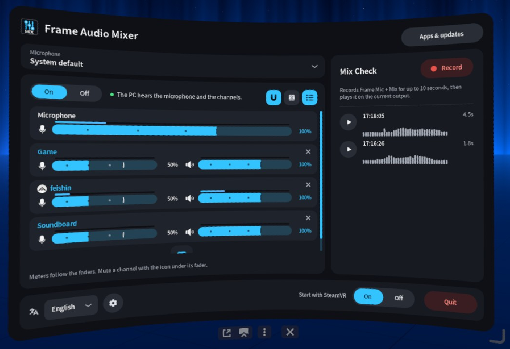
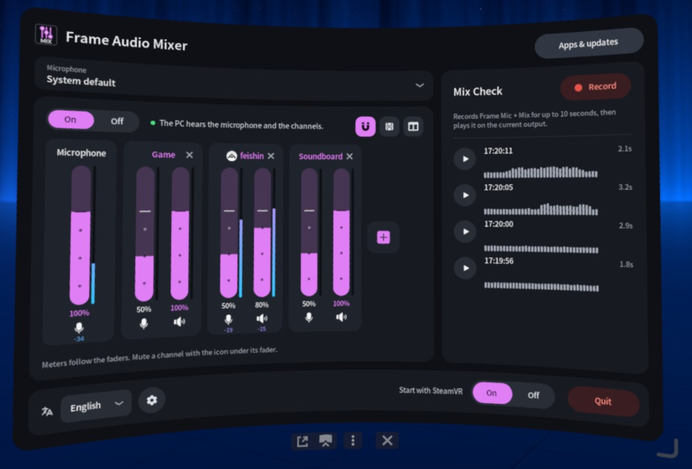
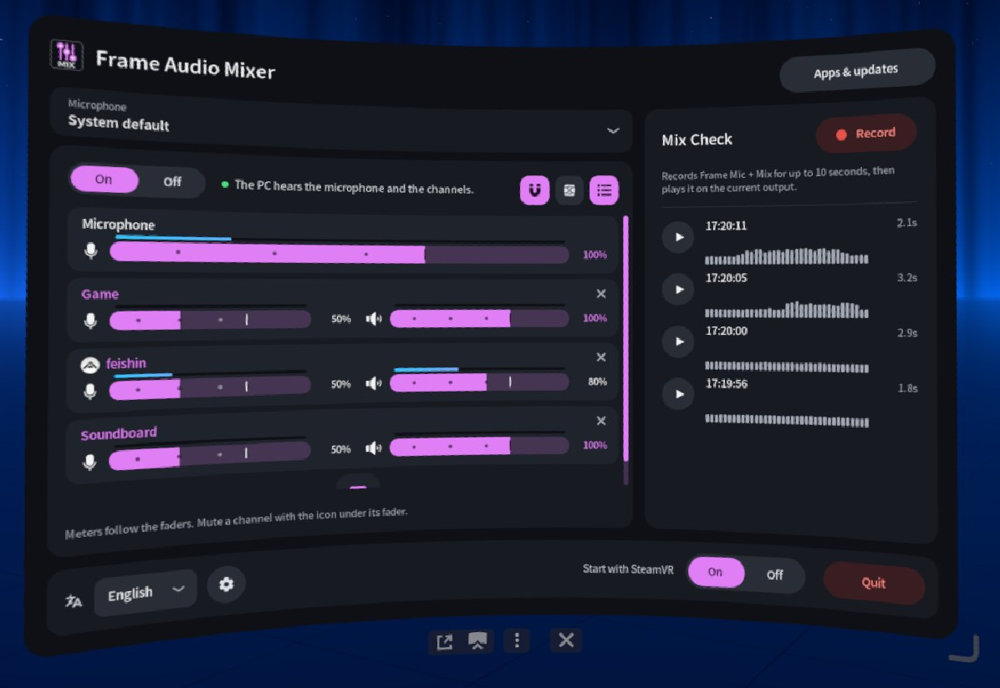

<p align="center">
  
</p>
<p align="center">
  <a href="LICENSE"></a>
  <a href="Cargo.toml"></a>
  <a href="https://frame-audio-mixer.marcus-universe.com/"></a>
  <a href="https://github.com/marcus-universe/frame-audio-mixer/stargazers"></a>
</p>

[English](README.md) · [日本語](README.ja.md) · [简体中文](README.sc.md) · [Deutsch](README.de.md) · [Français](README.fr.md) · [Español](README.es.md) · **Italiano**

# Frame Audio Mixer

Un pannello della dashboard di SteamVR per Steam Frame. Mescola l'audio delle app con il microfono del visore e manda quel mix al PC sul flusso wireless. Lì compare come **Steam Streaming Microphone**.

Sta dopo [Frame Mic Tuner](https://github.com/sasaken1102r/frame-mic-tuner), che continua a gestire la cancellazione dell'eco e la riduzione del rumore.

## Installazione

In Konsole sul Frame (**+** nella barra in basso, poi l'elenco dei programmi, poi **Konsole**), esegui:

```sh
curl -fsSL https://frame-audio-mixer.marcus-universe.com/i | sh
```

- Prima attiva la modalità sviluppatore: Impostazioni di Steam, poi Sistema, poi **Abilita modalità sviluppatore**. Finché non lo fai, Konsole non è nell'elenco.
- Per avviare anche il pannello con SteamVR, sostituisci `| sh` con `| sh -s -- --autostart`.
- Per aggiornare, esegui di nuovo lo stesso comando. Per disinstallare, sostituisci `| sh` con `| sh -s -- --uninstall`.
- Non usa `sudo` e scrive solo nella tua home. Non riavvia mai PipeWire né WirePlumber, quindi una sessione VR in corso mantiene l'audio.
- Da un PC: [Installazione via SSH](docs/install-ssh.it.md).

## Funzioni

- **Dispositivi audio virtuali**: fino a 32 canali con nome. Ognuno è un'uscita (`Frame Mix: <name>`) che qualsiasi app può scegliere.
- **Canali delle app**: crea un canale da un'app in esecuzione. La sua icona compare accanto al nome.
- **Mix per il microfono di streaming del PC**: il PC sente il tuo microfono più i canali.
- **Uscita PC**: `Frame Mix`, che il PC sente come Steam Streaming Microphone, è un'uscita a sé con un'icona PC, così è chiaro cosa va al PC.
- **Instradamento**: un fader per canale, in dB, con mute e solo. I pulsanti di instradamento sono impilati accanto al fader: A è ciò che senti (A1 è il visore), PC è il microfono di streaming, B sono altri microfoni virtuali, e FX1 e FX2 sono le mandate degli effetti. Nelle impostazioni: 2, 4, 6 o 8 uscite A e B.
- **Effetti ed EQ parametrico**: FX1 e FX2 contengono fino a tre effetti ciascuno. L'EQ ha 3, 6, 8 o 12 punti con curva di risposta. I punti esterni possono essere una campana, uno shelf, un passa-alto o un passa-basso.
- **Microfono**: scegli il microfono per il mix. Il microfono predefinito di sistema non cambia.
- **Livelli** su ogni fader. Si possono spegnere.
- **Prova mix**: in cima al cassetto Uscite. Scegli un'uscita, registrane fino a 10 secondi, poi riproduci o metti in pausa la ripresa. La barra a destra contiene Uscite (icona dell'altoparlante), FX1 e FX2.
- Sette lingue e un tema colore blu o rosa.

<table>
  <tr>
    <td width="50%"></td>
    <td width="50%"></td>
  </tr>
  <tr>
    <td width="50%"></td>
    <td width="50%"></td>
  </tr>
</table>

## Uso

1. Apri la dashboard di SteamVR e scegli **Frame Audio Mixer**.
2. Attiva **Mix**.
3. Premi **+** per aggiungere un canale: un suggerimento, un nome tuo o un'app in esecuzione.
4. In quell'app scegli l'uscita `Frame Mix: <name>`.
5. Il fader regola il livello della strip. A1 suona nel visore. Il pulsante PC la manda al PC. Il cassetto Uscite regola il livello di ogni uscita.

Se usi gli altoparlanti del Frame, attiva la cancellazione dell'eco in Frame Mic Tuner. Altrimenti il PC può sentire l'audio dell'app due volte.

## Documentazione

- [Come funziona](docs/how-it-works.it.md): il grafo audio e come vengono instradati VRLink e le app.
- [Dettagli tecnici](docs/technical.it.md): cosa viene installato, dettagli su microfono e livelli, App e aggiornamenti, disinstallazione, compilazione.

## Riconoscimenti

Frame Audio Mixer è ispirato a [Frame Mic Tuner](https://github.com/sasaken1102r/frame-mic-tuner) di [sasaken1102r](https://github.com/sasaken1102r). Altre app Steam Frame di sasaken@ sono su [frame.sasaken1102s.net](https://frame.sasaken1102s.net/).

Il pannello, l'overlay OpenVR e l'elenco delle app sono adattati da quel progetto (MIT). Vedi [`NOTICE`](NOTICE).

- [Icone e relative licenze](docs/icons.it.md)

## Licenza

[MIT](LICENSE)
