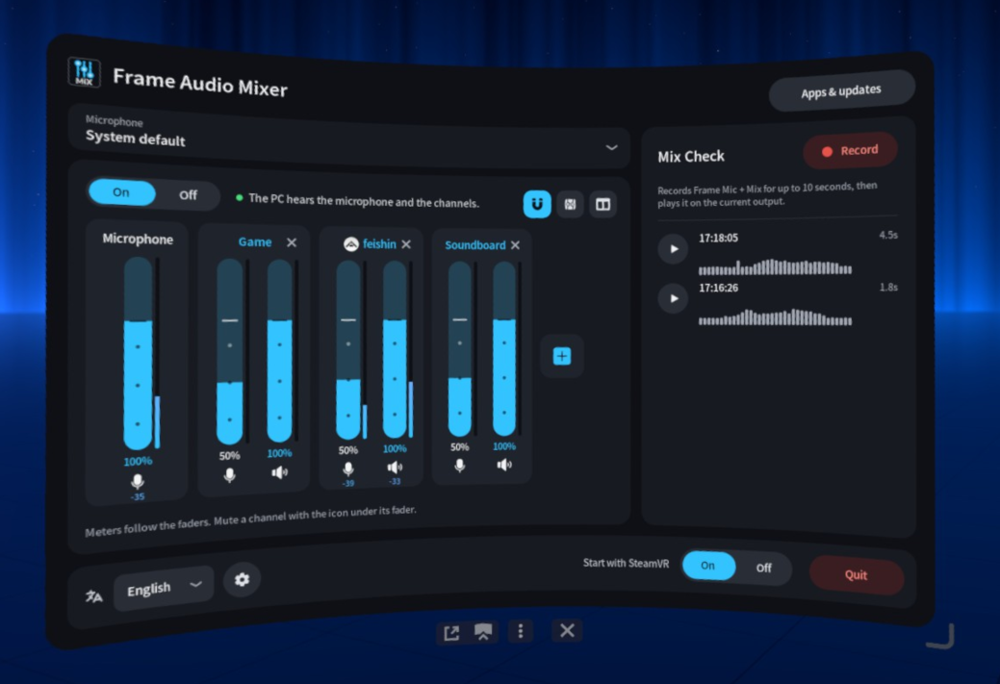
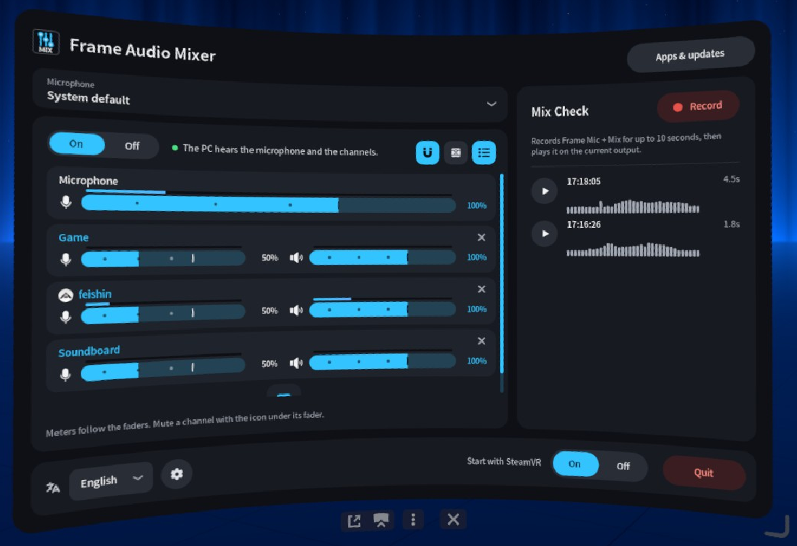
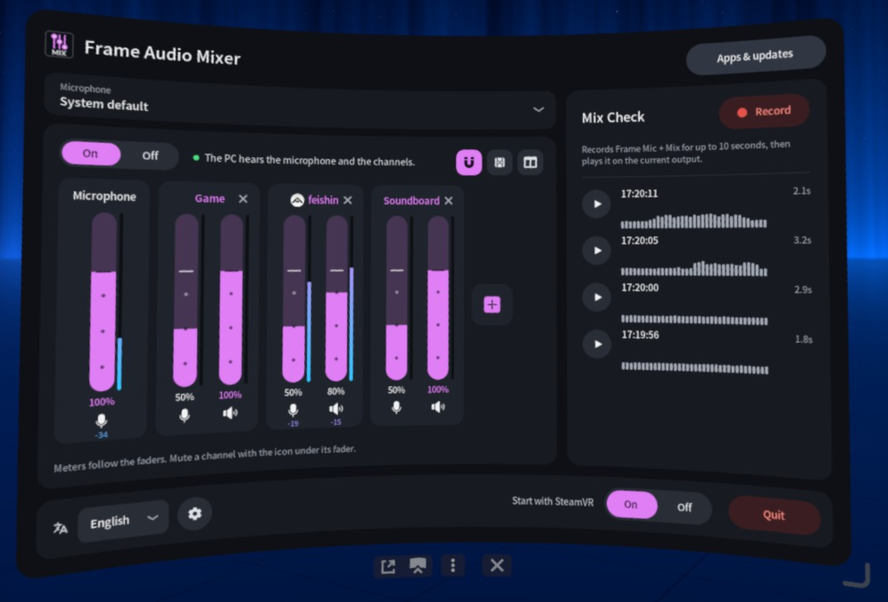
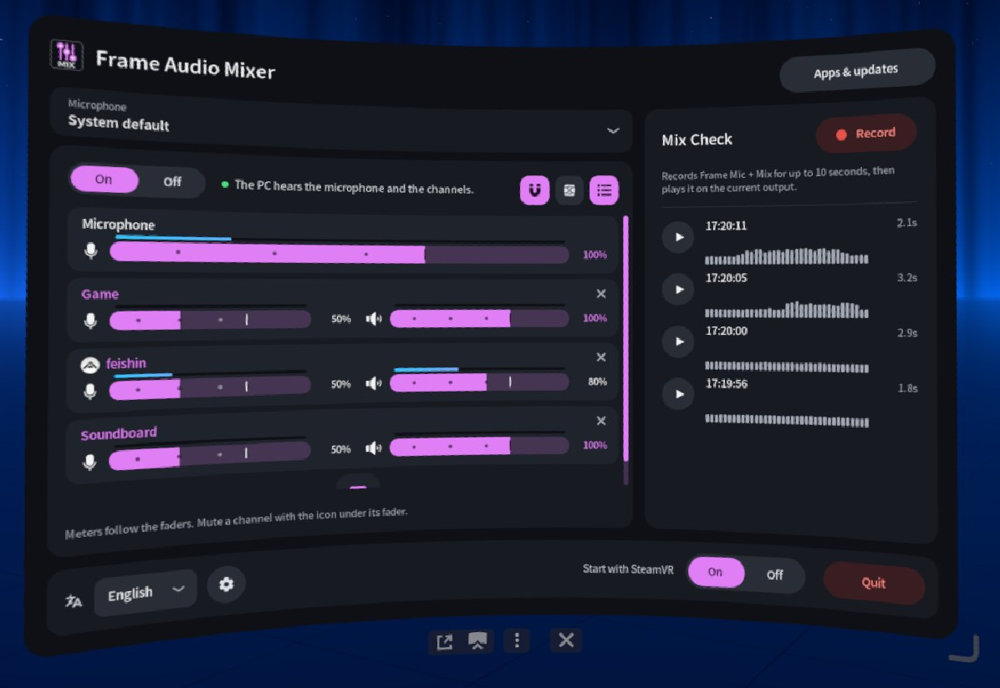

<p align="center">
  
</p>
<p align="center">
  <a href="LICENSE"></a>
  <a href="Cargo.toml"></a>
  <a href="https://frame-audio-mixer.marcus-universe.com/"></a>
  <a href="https://github.com/marcus-universe/frame-audio-mixer/stargazers"></a>
</p>

[English](README.md) · [日本語](README.ja.md) · **简体中文** · [Deutsch](README.de.md) · [Français](README.fr.md) · [Español](README.es.md) · [Italiano](README.it.md)

# Frame Audio Mixer

这是 Steam Frame 上的一个 SteamVR 仪表盘面板。它把应用的声音和头显麦克风混在一起，再通过无线串流把这份混音送给 PC。PC 上显示为 **Steam Streaming Microphone**。

它接在 [Frame Mic Tuner](https://github.com/sasaken1102r/frame-mic-tuner) 之后。回声消除和噪声抑制仍由 Frame Mic Tuner 负责。

## 安装

在 Frame 上打开 Konsole（底部栏上的 **+**，然后是程序列表，然后是 **Konsole**），运行：

```sh
curl -fsSL https://frame-audio-mixer.marcus-universe.com/i | sh
```

- 先打开开发者模式：Steam 设置，然后是系统，然后是 **启用开发者模式**。打开之前，列表里没有 Konsole。
- 如果还想让面板随 SteamVR 启动，把 `| sh` 换成 `| sh -s -- --autostart`。
- 更新时，再运行一次同一条命令。卸载时，把 `| sh` 换成 `| sh -s -- --uninstall`。
- 它不使用 `sudo`，只写入你的主目录。它从不重启 PipeWire 或 WirePlumber，所以正在进行的 VR 会话不会失去声音。
- 从 PC 安装：[通过 SSH 安装](docs/install-ssh.sc.md)。

## 功能

- **虚拟音频设备**：最多 32 个命名通道。每个通道都是一个输出（`Frame Mix: <name>`），任何应用都可以选择它。
- **应用通道**：用正在运行的应用创建通道。名称旁边会显示它的图标。
- **PC 串流麦克风混音**：PC 听到的是你的麦克风加上各个通道。
- **PC 输出**：`Frame Mix` 就是 PC 听到的 Steam Streaming Microphone，它是一个单独的输出，带 PC 图标，所以一眼就能看出什么会送到 PC。
- **路由**：每个通道一个推子，以 dB 显示，带静音和独奏。路由按钮竖排在推子旁边：A 是你听到的（A1 是头显），PC 是串流麦克风，B 是更多虚拟麦克风，FX1 和 FX2 是效果发送。设置里可选 2、4、6 或 8 个 A 和 B 输出。
- **效果和参量均衡**：FX1 和 FX2 各可放最多三个效果。均衡有 3、6、8 或 12 个点，带响应曲线。外侧的点可以是钟形、搁架、高通或低通。
- **麦克风**：选择用于混音的麦克风。系统默认麦克风不会改变。
- 每个推子上都有 **电平表**。可以关闭。
- **混音检查**：在输出抽屉顶部。选择一个输出，录制最多 10 秒，然后播放或暂停这段录音。右侧栏是输出（扬声器图标）、FX1 和 FX2。
- 七种语言，以及蓝色或粉色的配色主题。

<table>
  <tr>
    <td width="50%"></td>
    <td width="50%"></td>
  </tr>
  <tr>
    <td width="50%"></td>
    <td width="50%"></td>
  </tr>
</table>

## 使用

1. 打开 SteamVR 仪表盘，选择 **Frame Audio Mixer**。
2. 打开 **混音**。
3. 按 **+** 添加通道：可以选建议、自己起的名称，或者正在运行的应用。
4. 在那个应用里选择输出 `Frame Mix: <name>`。
5. 推子决定这条通道的电平。A1 在头显里播放。PC 按钮把它送到 PC。输出抽屉设置每个输出的电平。

如果使用 Frame 的扬声器，请在 Frame Mic Tuner 里打开回声消除。否则 PC 可能听到两遍应用的声音。

## 文档

- [工作方式](docs/how-it-works.sc.md)：音频图，以及 VRLink 和应用如何路由。
- [技术细节](docs/technical.sc.md)：安装了什么、麦克风和电平表的细节、应用和更新、卸载、构建。

## 致谢

Frame Audio Mixer 的灵感来自 [sasaken1102r](https://github.com/sasaken1102r) 的 [Frame Mic Tuner](https://github.com/sasaken1102r/frame-mic-tuner)。更多ささけん＠的 Steam Frame 应用见 [frame.sasaken1102s.net](https://frame.sasaken1102s.net/)。

面板、OpenVR overlay 和应用列表改编自该项目（MIT）。见 [`NOTICE`](NOTICE)。

- [图标及其许可](docs/icons.sc.md)

## 许可

[MIT](LICENSE)
