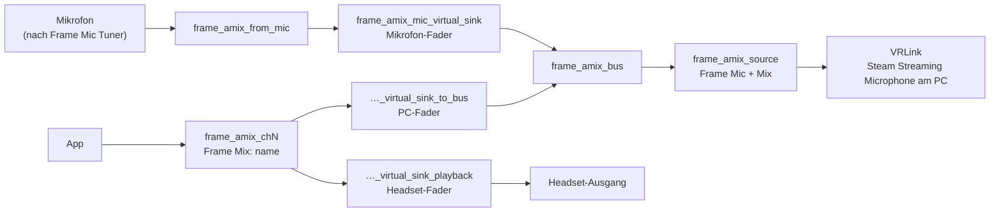

[English](how-it-works.md) · [日本語](how-it-works.ja.md) · [简体中文](how-it-works.sc.md) · **Deutsch** · [Français](how-it-works.fr.md) · [Español](how-it-works.es.md) · [Italiano](how-it-works.it.md)

[← README](../README.de.md)

# So funktioniert es

## Das Mikrofon

Die Mischung beginnt mit dem Mikrofon, das im Panel gewählt ist. **Systemstandard** folgt der Standardquelle. Auf der Frame ist das das eingebaute Mikrofon nach den Valve-Filtern (Rauschunterdrückung, Echounterdrückung und Mikrofon-EQ), die Frame Mic Tuner steuert. Diese App ändert diese Filter nie und ändert nie den Systemstandard.

## Der Kern-Graph

`frame-audio-mixer-graph.service` baut den Kern:

- `frame_amix_from_mic` nimmt das gewählte Mikrofon auf.
- `frame_amix_mic_virtual_sink` ist der Mikrofon-Fader. Er spielt in `frame_amix_bus`.
- `frame_amix_source` (**Frame Mic + Mix**) ist die Quelle, die VRLink aufnimmt.

Die Mikrofon-Stummschaltung im Panel schaltet nur `frame_amix_mic_virtual_sink` stumm. Das Systemmikrofon und die Kanäle werden nicht stummgeschaltet.

## Kanäle

Jeder Kanal ist ein eigener `frame-audio-mixer-channel@chN.service`, von `ch1` bis `ch32`:

- `frame_amix_chN` ist der Ausgang, den Apps wählen (`Frame Mix: <name>`).
- `frame_amix_chN_virtual_sink_playback` spielt ihn im Headset ab. Das ist der Headset-Fader.
- `frame_amix_chN_virtual_sink_to_bus` schickt denselben Ton in den Mix-Bus. Das ist der PC-Fader.

Beim Hinzufügen oder Entfernen eines Kanals wird nur diese Unit gestartet oder gestoppt. PipeWire und WirePlumber laufen weiter.

Die internen Wiedergabenamen enthalten sowohl `virtual` als auch `sink`. Deshalb packt das räumliche Audio von SteamOS sie nicht ein und schickt die Mischung nicht ein zweites Mal auf die Lautsprecher. Kanalausgänge heißen weder `alsa_output` noch `bluez_output` und erscheinen deshalb nicht in der Ausgangsliste von Frame Mic Tuner.

## Routing zum PC

Solange Mix an ist (`frame-audio-mixer.enabled` ist true), richtet die WirePlumber-Komponente `custom.frame-audio-mixer` den VRLink-Aufnahmestream auf `frame_amix_source`. Sie schreibt die `object.serial` dieser Quelle in die Standard-Metadaten, weil ein Knotenname dort den Stream nicht verschiebt. Fehlt die Quelle, bleibt VRLink beim normalen Standardmikrofon. Andere Apps, die das Mikrofon aufnehmen, werden nicht verschoben.

`frame-audio-mixer.vrlink-gain` ist standardmäßig `1.0`. Damit bleibt die Lautstärke von VRLink, wie sie ist. Jeder andere Wert gilt, solange Mix an ist, und beim Ausschalten von Mix kommt die vorherige Lautstärke zurück.

## Apps auf Kanäle routen

Eine App, die `Frame Mix: <name>` wählt, läuft trotzdem durch das räumliche Audio, und ein Knotenname als Ziel wird ignoriert. Deshalb pinnt Frame Audio Mixer den Stream über die `object.serial` des Ausgangs auf den Kanal. Das WirePlumber-Skript und das Panel tun das beide. Die Serial ändert sich, wenn ein Kanal neu startet, und der Pin wird neu geschrieben, sobald der Ausgang wieder da ist. Wird ein Ausgang entfernt, wird der Pin gelöscht, und die App fällt auf den normalen Ausgang zurück.

Ein Kanal, der aus einer laufenden App angelegt wurde, merkt sich auch diese App. Solange Mix an ist, werden ihre Streams auf den Kanal gepinnt, auch wenn die App keine Ausgangseinstellung hat.

Nichts in dieser App ruft `wpctl set-default` auf.

## Echounterdrückung

Mit den Lautsprechern der Frame kann das Mikrofon die Lautsprecher hören. Die Lautsprecher spielen die Kanäle schon ab. Ohne Echounterdrückung hört der PC den App-Ton deshalb doppelt: einmal aus der Mischung und einmal über die Luft. Bei den Lautsprechern die Echounterdrückung in Frame Mic Tuner einschalten. Kopfhörer haben dieses Problem nicht.
