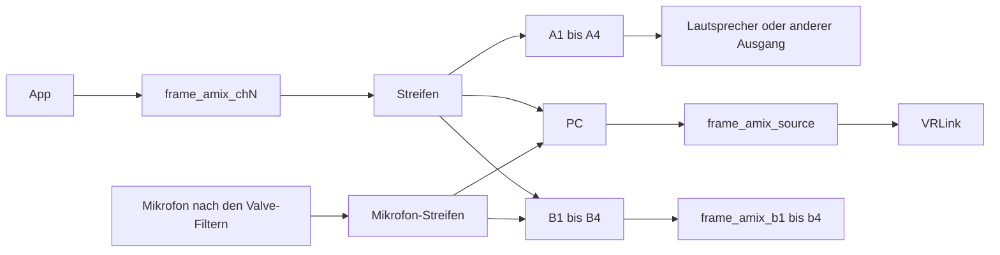

[English](how-it-works.md) · [日本語](how-it-works.ja.md) · [简体中文](how-it-works.sc.md) · **Deutsch** · [Français](how-it-works.fr.md) · [Español](how-it-works.es.md) · [Italiano](how-it-works.it.md)

[← README](../README.de.md)

# So funktioniert es

## Das Mikrofon

Die Mischung beginnt mit dem Mikrofon, das im Panel gewählt ist. **Systemstandard** folgt der Standardquelle. **Frame-Mikrofon** ist das eingebaute Mikrofon nach den Valve-Filtern. Frame Mic Tuner steuert diese Filter. Diese App ändert sie nie und ändert nie den Systemstandard.

## Die Engine

`frame-audio-mixer-engine.service` besitzt den Graphen. Die Mischung läuft weiter, wenn das Panel schließt.

- Jeder Kanal ist ein Sink `frame_amix_chN`. Apps sehen ihn unter dem Kanalnamen (`DJ`).
- Der Streifen wendet Fader, Stumm, Solo und den Pegel an und schickt das Signal auf die Ausgänge, die mit den Knöpfen neben seinem Fader eingeschaltet sind.
- A1 sind die Headset-Lautsprecher. A2 bis A4 sind der gewählte Ausgang.
- PC (das Symbol mit Monitor und Lautsprecher) ist `frame_amix_source` (**Frame Mix**), das Mikrofon, das der PC hört. Es ist ein eigener Ausgang, zusätzlich zu den 2, 4, 6 oder 8 A- und B-Ausgängen.
- B1 bis B4 sind weitere virtuelle Mikrofone (`frame_amix_b1` bis `frame_amix_b4`) für andere Apps auf dem Headset.
- Der Mikrofon-Streifen geht standardmäßig nur auf PC. Die Aufnahme ist nicht virtuell, deshalb bleibt die Rauschunterdrückung an, solange Mix an ist.

Ein Kanal erzeugt oder löscht nur seine eigenen Nodes. PipeWire und WirePlumber werden nicht neu gestartet.

Interne Namen enthalten `virtual` und `sink`, deshalb packt das räumliche Audio sie nicht ein.

## Routing zum PC

Solange Mix an ist (`frame-audio-mixer.enabled` ist true), richtet die WirePlumber-Komponente `custom.frame-audio-mixer` den VRLink-Aufnahmestream auf `frame_amix_source`. Sie schreibt die `object.serial` dieser Quelle in die Standard-Metadaten, weil ein Knotenname dort den Stream nicht verschiebt. Fehlt die Quelle, bleibt VRLink beim normalen Standardmikrofon. Andere Apps, die das Mikrofon aufnehmen, werden nicht verschoben.

`frame-audio-mixer.vrlink-gain` ist standardmäßig `1.0`. Damit bleibt die Lautstärke von VRLink, wie sie ist. Jeder andere Wert gilt, solange Mix an ist, und beim Ausschalten von Mix kommt die vorherige Lautstärke zurück.

## Apps auf Kanäle routen

Eine App, die `Frame Mix: <name>` wählt, läuft trotzdem durch das räumliche Audio, und ein Knotenname als Ziel wird ignoriert. Deshalb pinnt Frame Audio Mixer den Stream über die `object.serial` des Ausgangs auf den Kanal. Das WirePlumber-Skript und das Panel tun das beide. Die Serial ändert sich, wenn ein Kanal neu startet, und der Pin wird neu geschrieben, sobald der Ausgang wieder da ist. Wird ein Ausgang entfernt, wird der Pin gelöscht, und die App fällt auf den normalen Ausgang zurück.

Ein Kanal, der aus einer laufenden App angelegt wurde, merkt sich auch diese App. Solange Mix an ist, werden ihre Streams auf den Kanal gepinnt, auch wenn die App keine Ausgangseinstellung hat.

Nichts in dieser App ruft `wpctl set-default` auf.

## Mix-Check

Mix-Check sitzt oben in der Ausgänge-Schublade. Einen Ausgang wählen (PC, A oder B) und Aufnahme drücken, dann nimmt die Engine ihn bis zu 10 Sekunden auf. Wiedergabe und Pause spielen genau diese eine Aufnahme auf A1 ab. Eine neue Aufnahme ersetzt sie. Während der Aufnahme oder Wiedergabe bleibt das Mikrofon aus der Mischung, und die Effekt-Returns im Headset sind stumm. So wird die Aufnahme nicht mitgehört und kann nicht rückkoppeln.

## Effekte

Effekte sitzen auf FX1 und FX2, zwei Effektketten, die jeder Streifen neben seinem Fader einschalten kann. Jede Kette fasst bis zu drei Effekte. Der Equalizer ist einer davon: parametrisch, mit 3, 6, 8 oder 12 Punkten und einer Frequenzgangkurve. Sein Knopf Bearbeiten öffnet die volle EQ-Ansicht. Der erste und der letzte Punkt können Glocke, Shelf, Hochpass oder Tiefpass sein. Die Effekte laufen im Streifen selbst: Das Ergebnis ersetzt den Klang des Streifens und geht an die Ausgänge, die für diesen Streifen gewählt sind. Eine zweite, trockene Kopie gibt es nicht. Sind beide an, kommt FX1 zuerst. Jede Kette hat einen Pegel-Fader.

## Echounterdrückung

Mit den Lautsprechern der Frame kann das Mikrofon die Lautsprecher hören. Die Lautsprecher spielen die Kanäle schon ab. Ohne Echounterdrückung hört der PC den App-Ton deshalb doppelt: einmal aus der Mischung und einmal über die Luft. Bei den Lautsprechern die Echounterdrückung in Frame Mic Tuner einschalten. Kopfhörer haben dieses Problem nicht.
