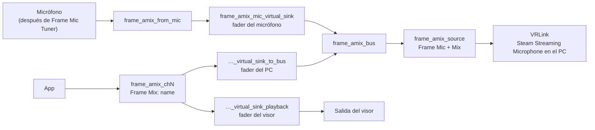

[English](how-it-works.md) · [日本語](how-it-works.ja.md) · [简体中文](how-it-works.sc.md) · [Deutsch](how-it-works.de.md) · [Français](how-it-works.fr.md) · **Español** · [Italiano](how-it-works.it.md)

[← README](../README.es.md)

# Cómo funciona

## El micrófono

La mezcla empieza con el micrófono que elegiste en el panel. **Predeterminado del sistema** sigue la fuente predeterminada. En el Frame es el micrófono integrado después de los filtros de Valve (reducción de ruido, cancelación de eco y el EQ del micrófono), que controla Frame Mic Tuner. Esta app nunca cambia esos filtros ni el predeterminado del sistema.

## El grafo principal

`frame-audio-mixer-graph.service` construye el núcleo:

- `frame_amix_from_mic` graba el micrófono elegido.
- `frame_amix_mic_virtual_sink` es el fader del micrófono. Reproduce hacia `frame_amix_bus`.
- `frame_amix_source` (**Frame Mic + Mix**) es la fuente que graba VRLink.

El silencio del micrófono en el panel solo silencia `frame_amix_mic_virtual_sink`. El micrófono del sistema y los canales no se silencian.

## Canales

Cada canal es su propio `frame-audio-mixer-channel@chN.service`, de `ch1` a `ch32`:

- `frame_amix_chN` es la salida que eligen las apps (`Frame Mix: <name>`).
- `frame_amix_chN_virtual_sink_playback` la reproduce en el visor. Es el fader del visor.
- `frame_amix_chN_virtual_sink_to_bus` envía el mismo audio al bus de mezcla. Es el fader del PC.

Añadir o quitar un canal solo arranca o detiene esa unidad. PipeWire y WirePlumber siguen en marcha.

Los nombres internos de reproducción contienen `virtual` y `sink`. Por eso el audio espacial de SteamOS no los envuelve ni manda la mezcla a los altavoces una segunda vez. Las salidas de los canales no se llaman `alsa_output` ni `bluez_output`, así que no aparecen en la lista de salidas de Frame Mic Tuner.

## Enrutamiento al PC

Mientras la mezcla está activa (`frame-audio-mixer.enabled` es verdadero), el componente de WirePlumber `custom.frame-audio-mixer` apunta el flujo de captura de VRLink a `frame_amix_source`. Escribe el `object.serial` de esa fuente en los metadatos predeterminados, porque un nombre de nodo ahí no mueve el flujo. Si falta la fuente, VRLink sigue con el micrófono predeterminado normal. Las demás apps que graban el micrófono no se mueven.

`frame-audio-mixer.vrlink-gain` vale `1.0` de forma predeterminada, lo que deja el volumen de VRLink como está. Cualquier otro valor se aplica mientras la mezcla está activa, y el volumen anterior vuelve cuando la mezcla se apaga.

## Enrutamiento de apps a canales

Una app que elige `Frame Mix: <name>` sigue pasando por el audio espacial, y un nombre de nodo como destino se ignora. Por eso Frame Audio Mixer fija el flujo al canal mediante el `object.serial` de la salida. Lo hacen tanto el script de WirePlumber como el panel. El serial cambia cuando un canal se reinicia, y la fijación se vuelve a escribir cuando la salida reaparece. Cuando se quita una salida, la fijación se borra y la app vuelve a la salida normal.

Un canal creado a partir de una app en ejecución también recuerda esa app. Mientras la mezcla está activa, sus flujos se fijan al canal aunque la app no tenga ajuste de salida.

Nada en esta app llama a `wpctl set-default`.

## Cancelación de eco

Con los altavoces del Frame, el micrófono puede oír los altavoces. Los altavoces ya reproducen los canales, así que sin cancelación de eco el PC oye el audio de la app dos veces: una desde la mezcla y otra por el aire. Activa la cancelación de eco en Frame Mic Tuner cuando uses los altavoces. Con auriculares no pasa.
