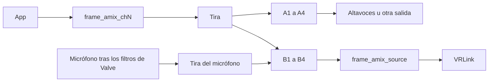

[English](how-it-works.md) · [日本語](how-it-works.ja.md) · [简体中文](how-it-works.sc.md) · [Deutsch](how-it-works.de.md) · [Français](how-it-works.fr.md) · **Español** · [Italiano](how-it-works.it.md)

[← README](../README.es.md)

# Cómo funciona

## El micrófono

La mezcla empieza con el micrófono elegido en el panel. **Predeterminado del sistema** sigue la fuente predeterminada. **Micrófono del Frame** es el integrado después de los filtros de Valve. Frame Mic Tuner los controla. Esta app no los cambia ni cambia el predeterminado del sistema.

## El motor

`frame-audio-mixer-engine.service` posee el grafo. La mezcla sigue cuando el panel se cierra.

- Cada canal es un sink `frame_amix_chN`. Las apps lo ven con el nombre del canal (`DJ`).
- La tira aplica inserciones, fader, silencio, solo y el medidor, y envía a los buses A y B encendidos.
- A1 son los altavoces del visor. A2 a A4 son la salida elegida.
- B1 es `frame_amix_source` (**Frame Mix**). B2 a B4 son más micrófonos virtuales.
- La tira del micrófono va por defecto solo a B1. La captura no es virtual, así que la reducción de ruido sigue activa mientras Mix está encendido.

Añadir o quitar un canal solo crea o destruye sus nodos. PipeWire y WirePlumber no se reinician.

Los nombres internos contienen `virtual` y `sink`, así que el audio espacial no los envuelve.

## Enrutamiento al PC

Mientras la mezcla está activa (`frame-audio-mixer.enabled` es verdadero), el componente de WirePlumber `custom.frame-audio-mixer` apunta el flujo de captura de VRLink a `frame_amix_source`. Escribe el `object.serial` de esa fuente en los metadatos predeterminados, porque un nombre de nodo ahí no mueve el flujo. Si falta la fuente, VRLink sigue con el micrófono predeterminado normal. Las demás apps que graban el micrófono no se mueven.

`frame-audio-mixer.vrlink-gain` vale `1.0` de forma predeterminada, lo que deja el volumen de VRLink como está. Cualquier otro valor se aplica mientras la mezcla está activa, y el volumen anterior vuelve cuando la mezcla se apaga.

## Enrutamiento de apps a canales

Una app que elige `Frame Mix: <name>` sigue pasando por el audio espacial, y un nombre de nodo como destino se ignora. Por eso Frame Audio Mixer fija el flujo al canal mediante el `object.serial` de la salida. Lo hacen tanto el script de WirePlumber como el panel. El serial cambia cuando un canal se reinicia, y la fijación se vuelve a escribir cuando la salida reaparece. Cuando se quita una salida, la fijación se borra y la app vuelve a la salida normal.

Un canal creado a partir de una app en ejecución también recuerda esa app. Mientras la mezcla está activa, sus flujos se fijan al canal aunque la app no tenga ajuste de salida.

Nada en esta app llama a `wpctl set-default`.

## Cancelación de eco

Con los altavoces del Frame, el micrófono puede oír los altavoces. Los altavoces ya reproducen los canales, así que sin cancelación de eco el PC oye el audio de la app dos veces: una desde la mezcla y otra por el aire. Activa la cancelación de eco en Frame Mic Tuner cuando uses los altavoces. Con auriculares no pasa.
