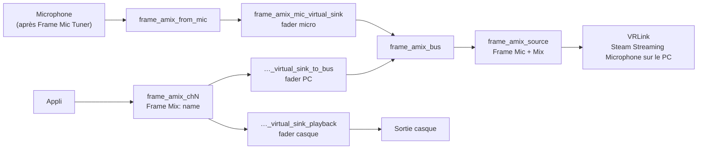

[English](how-it-works.md) · [日本語](how-it-works.ja.md) · [简体中文](how-it-works.sc.md) · [Deutsch](how-it-works.de.md) · **Français** · [Español](how-it-works.es.md) · [Italiano](how-it-works.it.md)

[← README](../README.fr.md)

# Fonctionnement

## Le micro

Le mix part du micro choisi dans le panneau. **Défaut du système** suit la source par défaut. Sur le Frame, c'est le micro intégré après les filtres de Valve (réduction de bruit, annulation d'écho et égaliseur du micro), que Frame Mic Tuner contrôle. Cette appli ne change jamais ces filtres et ne change jamais le réglage par défaut du système.

## Le cœur du graphe

`frame-audio-mixer-graph.service` construit le cœur :

- `frame_amix_from_mic` enregistre le micro choisi.
- `frame_amix_mic_virtual_sink` est le fader du micro. Il joue dans `frame_amix_bus`.
- `frame_amix_source` (**Frame Mic + Mix**) est la source qu'enregistre VRLink.

La sourdine du micro dans le panneau ne coupe que `frame_amix_mic_virtual_sink`. Le micro du système et les canaux ne sont pas coupés.

## Canaux

Chaque canal est son propre `frame-audio-mixer-channel@chN.service`, de `ch1` à `ch32` :

- `frame_amix_chN` est la sortie que choisissent les applis (`Frame Mix: <name>`).
- `frame_amix_chN_virtual_sink_playback` la joue dans le casque. C'est le fader casque.
- `frame_amix_chN_virtual_sink_to_bus` envoie le même son dans le bus de mixage. C'est le fader PC.

Ajouter ou retirer un canal ne démarre ou n'arrête que cette unité. PipeWire et WirePlumber continuent de tourner.

Les noms de lecture internes contiennent à la fois `virtual` et `sink`. C'est pourquoi l'audio spatial de SteamOS ne les enveloppe pas et n'envoie pas le mix une seconde fois vers les haut-parleurs. Les sorties des canaux ne s'appellent ni `alsa_output` ni `bluez_output`, donc elles n'apparaissent pas dans la liste des sorties de Frame Mic Tuner.

## Routage vers le PC

Tant que Mix est actif (`frame-audio-mixer.enabled` est vrai), le composant WirePlumber `custom.frame-audio-mixer` dirige le flux de capture VRLink vers `frame_amix_source`. Il écrit l'`object.serial` de cette source dans les métadonnées par défaut, car un nom de nœud à cet endroit ne déplace pas le flux. Si la source manque, VRLink garde le micro par défaut habituel. Les autres applis qui enregistrent le micro ne sont pas déplacées.

`frame-audio-mixer.vrlink-gain` vaut `1.0` par défaut, ce qui laisse le volume de VRLink tel quel. Toute autre valeur s'applique tant que Mix est actif, et le volume précédent revient quand Mix s'arrête.

## Routage des applis vers les canaux

Une appli qui choisit `Frame Mix: <name>` passe quand même par l'audio spatial, et un nom de nœud comme cible est ignoré. Frame Audio Mixer épingle donc le flux au canal avec l'`object.serial` de la sortie. Le script WirePlumber et le panneau le font tous les deux. Le serial change quand un canal redémarre, et l'épingle est réécrite quand la sortie revient. Quand une sortie est retirée, l'épingle est effacée et l'appli revient à la sortie habituelle.

Un canal créé à partir d'une appli en cours se souvient aussi de cette appli. Tant que Mix est actif, ses flux sont épinglés au canal, même si l'appli n'a pas de réglage de sortie.

Rien dans cette appli n'appelle `wpctl set-default`.

## Annulation d'écho

Avec les haut-parleurs du Frame, le micro peut entendre les haut-parleurs. Ceux-ci jouent déjà les canaux, donc sans annulation d'écho le PC entend le son de l'appli deux fois : une fois par le mix et une fois par l'air. Activez l'annulation d'écho dans Frame Mic Tuner quand vous utilisez les haut-parleurs. Les écouteurs n'ont pas ce problème.
