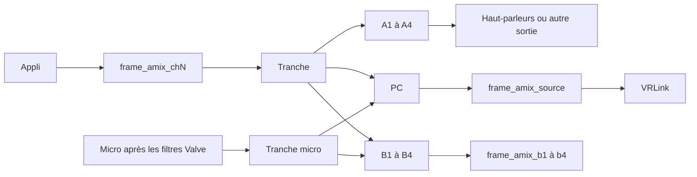

[English](how-it-works.md) · [日本語](how-it-works.ja.md) · [简体中文](how-it-works.sc.md) · [Deutsch](how-it-works.de.md) · **Français** · [Español](how-it-works.es.md) · [Italiano](how-it-works.it.md)

[← README](../README.fr.md)

# Fonctionnement

## Le micro

Le mix part du micro choisi dans le panneau. **Défaut du système** suit la source par défaut. **Micro du Frame** est le micro intégré après les filtres de Valve. Frame Mic Tuner les contrôle. Cette appli ne les change pas et ne change pas le réglage par défaut du système.

## Le moteur

`frame-audio-mixer-engine.service` possède le graphe. Le mix continue quand le panneau se ferme.

- Chaque canal est un sink `frame_amix_chN`. Les applis le voient sous le nom du canal (`DJ`).
- La tranche applique le fader, la sourdine, le solo et le niveau, puis envoie vers les sorties allumées avec les boutons à côté de son fader.
- A1, ce sont les haut-parleurs du casque. A2 à A4, c'est la sortie choisie.
- PC (l'icône écran et haut-parleur) est `frame_amix_source` (**Frame Mix**), le micro que le PC entend. C'est une sortie à part, en plus des 2, 4, 6 ou 8 sorties A et B.
- B1 à B4 sont d'autres micros virtuels (`frame_amix_b1` à `frame_amix_b4`) pour les autres applis du casque.
- La tranche micro va par défaut seulement vers PC. La capture n'est pas virtuelle, donc la réduction de bruit reste active tant que Mix est allumé.

Ajouter ou retirer un canal ne crée ou ne détruit que ses nœuds. PipeWire et WirePlumber ne redémarrent pas.

Les noms internes contiennent `virtual` et `sink`, donc l'audio spatial ne les enveloppe pas.

## Routage vers le PC

Tant que Mix est actif (`frame-audio-mixer.enabled` est vrai), le composant WirePlumber `custom.frame-audio-mixer` dirige le flux de capture VRLink vers `frame_amix_source`. Il écrit l'`object.serial` de cette source dans les métadonnées par défaut, car un nom de nœud à cet endroit ne déplace pas le flux. Si la source manque, VRLink garde le micro par défaut habituel. Les autres applis qui enregistrent le micro ne sont pas déplacées.

`frame-audio-mixer.vrlink-gain` vaut `1.0` par défaut, ce qui laisse le volume de VRLink tel quel. Toute autre valeur s'applique tant que Mix est actif, et le volume précédent revient quand Mix s'arrête.

## Routage des applis vers les canaux

Une appli qui choisit `Frame Mix: <name>` passe quand même par l'audio spatial, et un nom de nœud comme cible est ignoré. Frame Audio Mixer épingle donc le flux au canal avec l'`object.serial` de la sortie. Le script WirePlumber et le panneau le font tous les deux. Le serial change quand un canal redémarre, et l'épingle est réécrite quand la sortie revient. Quand une sortie est retirée, l'épingle est effacée et l'appli revient à la sortie habituelle.

Un canal créé à partir d'une appli en cours se souvient aussi de cette appli. Tant que Mix est actif, ses flux sont épinglés au canal, même si l'appli n'a pas de réglage de sortie.

Rien dans cette appli n'appelle `wpctl set-default`.

## Contrôle du mix

Le contrôle du mix se trouve en haut du tiroir Sorties. Choisissez une sortie (PC, A ou B), appuyez sur Enregistrer, et le moteur l'enregistre jusqu'à 10 secondes. Lecture et Pause jouent cette seule prise sur A1 ; un nouvel enregistrement la remplace. Pendant l'enregistrement ou la lecture, le micro est retiré du mix et les retours d'effets du casque sont coupés, donc la prise n'est pas écoutée et ne peut pas provoquer de larsen.

## Effets

Les effets se trouvent sur FX1 et FX2, des envois partagés que chaque tranche peut allumer à côté de son fader. Chaque chaîne contient jusqu'à trois effets. L'égaliseur en fait partie : paramétrique, à 3, 6, 8 ou 12 points, avec une courbe de réponse. Son bouton Modifier ouvre la vue complète de l'égaliseur. Le premier et le dernier point peuvent être une cloche, un shelf, un passe-haut ou un passe-bas. Un envoi est une copie ; les routes directes restent. Chaque retour a un fader et les mêmes boutons A, PC et B qu'une tranche.

## Annulation d'écho

Avec les haut-parleurs du Frame, le micro peut entendre les haut-parleurs. Ceux-ci jouent déjà les canaux, donc sans annulation d'écho le PC entend le son de l'appli deux fois : une fois par le mix et une fois par l'air. Activez l'annulation d'écho dans Frame Mic Tuner quand vous utilisez les haut-parleurs. Les écouteurs n'ont pas ce problème.
