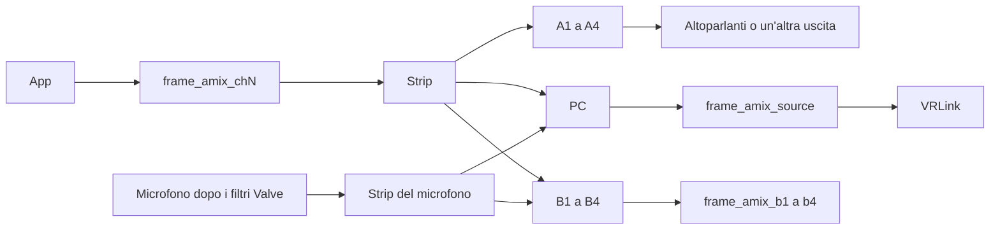

[English](how-it-works.md) · [日本語](how-it-works.ja.md) · [简体中文](how-it-works.sc.md) · [Deutsch](how-it-works.de.md) · [Français](how-it-works.fr.md) · [Español](how-it-works.es.md) · **Italiano**

[← README](../README.it.md)

# Come funziona

## Il microfono

Il mix parte dal microfono scelto nel pannello. **Predefinito di sistema** segue la sorgente predefinita. **Microfono del Frame** è quello interno dopo i filtri Valve. Li controlla Frame Mic Tuner. Questa app non li cambia e non cambia il predefinito di sistema.

## Il motore

`frame-audio-mixer-engine.service` possiede il grafo. Il mix continua quando il pannello si chiude.

- Ogni canale è un sink `frame_amix_chN`. Le app lo vedono con il nome del canale (`DJ`).
- La strip applica fader, mute, solo e il livello, poi manda alle uscite accese con i pulsanti accanto al suo fader.
- A1 sono gli altoparlanti del visore. Da A2 ad A4 è l'uscita scelta.
- PC (l'icona con monitor e altoparlante) è `frame_amix_source` (**Frame Mix**), il microfono che sente il PC. È un'uscita a sé, in aggiunta alle 2, 4, 6 o 8 uscite A e B.
- Da B1 a B4 sono altri microfoni virtuali (da `frame_amix_b1` a `frame_amix_b4`) per altre app sul visore.
- La strip del microfono va di default solo su PC. La cattura non è virtuale, quindi la riduzione del rumore resta attiva mentre Mix è acceso.

Aggiungere o togliere un canale crea o distrugge solo i suoi nodi. PipeWire e WirePlumber non vengono riavviati.

I nomi interni contengono `virtual` e `sink`, quindi l'audio spaziale non li avvolge.

## Instradamento verso il PC

Finché Mix è attivo (`frame-audio-mixer.enabled` è vero), il componente WirePlumber `custom.frame-audio-mixer` punta il flusso di cattura di VRLink su `frame_amix_source`. Scrive l'`object.serial` di quella sorgente nei metadati predefiniti, perché lì un nome di nodo non sposta il flusso. Se la sorgente manca, VRLink resta sul normale microfono predefinito. Le altre app che registrano il microfono non vengono spostate.

`frame-audio-mixer.vrlink-gain` vale `1.0` per impostazione predefinita, e così il volume di VRLink resta com'è. Ogni altro valore viene applicato finché Mix è attivo, e il volume precedente torna quando Mix si spegne.

## Instradamento delle app sui canali

Un'app che sceglie `Frame Mix: <name>` passa comunque dall'audio spaziale, e un nome di nodo come destinazione viene ignorato. Per questo Frame Audio Mixer aggancia il flusso al canale tramite l'`object.serial` dell'uscita. Lo fanno sia lo script WirePlumber sia il pannello. Il serial cambia quando un canale si riavvia, e l'aggancio viene riscritto quando l'uscita torna. Quando un'uscita viene rimossa, l'aggancio viene tolto e l'app torna all'uscita normale.

Un canale creato da un'app in esecuzione si ricorda anche di quell'app. Finché Mix è attivo, i suoi flussi vengono agganciati al canale anche se l'app non ha un'impostazione per l'uscita.

Niente in questa app chiama `wpctl set-default`.

## Prova mix

Prova mix si trova in cima al cassetto Uscite. Scegli un'uscita (PC, A o B), premi Registra e il motore la registra per un massimo di 10 secondi. Riproduci e Pausa suonano quella singola ripresa su A1; una nuova registrazione la sostituisce. Mentre registra o riproduce, il microfono resta fuori dal mix e i ritorni degli effetti nel visore sono in mute, così la ripresa non viene monitorata e non può andare in feedback.

## Effetti

Gli effetti stanno su FX1 e FX2, due catene di effetti che ogni strip può accendere accanto al suo fader. Ogni catena contiene fino a tre effetti. L'equalizzatore è uno di questi: parametrico, a 3, 6, 8 o 12 punti, con curva di risposta. Il suo pulsante Modifica apre la vista completa dell'EQ. Il primo e l'ultimo punto possono essere una campana, uno shelf, un passa-alto o un passa-basso. Gli effetti lavorano dentro la strip: il risultato sostituisce il suono della strip e va alle uscite scelte per quella strip, senza una seconda copia dry. Se sono attivi entrambi, FX1 viene per primo. Ogni catena ha un fader di livello.

## Cancellazione dell'eco

Con gli altoparlanti del Frame, il microfono può sentire gli altoparlanti. Gli altoparlanti riproducono già i canali, quindi senza cancellazione dell'eco il PC sente l'audio dell'app due volte: una dal mix e una attraverso l'aria. Attiva la cancellazione dell'eco in Frame Mic Tuner quando usi gli altoparlanti. Le cuffie non hanno questo problema.
