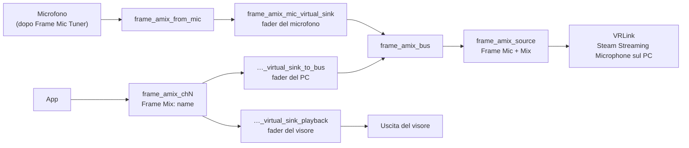

[English](how-it-works.md) · [日本語](how-it-works.ja.md) · [简体中文](how-it-works.sc.md) · [Deutsch](how-it-works.de.md) · [Français](how-it-works.fr.md) · [Español](how-it-works.es.md) · **Italiano**

[← README](../README.it.md)

# Come funziona

## Il microfono

Il mix parte dal microfono che hai scelto nel pannello. **Predefinito di sistema** segue la sorgente predefinita. Sul Frame è il microfono interno dopo i filtri Valve (riduzione del rumore, cancellazione dell'eco ed EQ del microfono), che Frame Mic Tuner controlla. Questa app non cambia mai quei filtri e non cambia mai il predefinito di sistema.

## Il grafo principale

`frame-audio-mixer-graph.service` costruisce il nucleo:

- `frame_amix_from_mic` registra il microfono scelto.
- `frame_amix_mic_virtual_sink` è il fader del microfono. Riproduce in `frame_amix_bus`.
- `frame_amix_source` (**Frame Mic + Mix**) è la sorgente che VRLink registra.

Il mute del microfono nel pannello silenzia solo `frame_amix_mic_virtual_sink`. Il microfono di sistema e i canali non vengono silenziati.

## Canali

Ogni canale è il proprio `frame-audio-mixer-channel@chN.service`, da `ch1` a `ch32`:

- `frame_amix_chN` è l'uscita che le app scelgono (`Frame Mix: <name>`).
- `frame_amix_chN_virtual_sink_playback` la riproduce nel visore. È il fader del visore.
- `frame_amix_chN_virtual_sink_to_bus` manda lo stesso audio nel bus del mix. È il fader del PC.

Aggiungere o rimuovere un canale avvia o ferma solo quell'unità. PipeWire e WirePlumber continuano a girare.

I nomi interni di riproduzione contengono sia `virtual` sia `sink`. Per questo l'audio spaziale di SteamOS non li avvolge e non manda il mix una seconda volta agli altoparlanti. Le uscite dei canali non si chiamano `alsa_output` né `bluez_output`, quindi non compaiono nell'elenco uscite di Frame Mic Tuner.

## Instradamento verso il PC

Finché Mix è attivo (`frame-audio-mixer.enabled` è vero), il componente WirePlumber `custom.frame-audio-mixer` punta il flusso di cattura di VRLink su `frame_amix_source`. Scrive l'`object.serial` di quella sorgente nei metadati predefiniti, perché lì un nome di nodo non sposta il flusso. Se la sorgente manca, VRLink resta sul normale microfono predefinito. Le altre app che registrano il microfono non vengono spostate.

`frame-audio-mixer.vrlink-gain` vale `1.0` per impostazione predefinita, e così il volume di VRLink resta com'è. Ogni altro valore viene applicato finché Mix è attivo, e il volume precedente torna quando Mix si spegne.

## Instradamento delle app sui canali

Un'app che sceglie `Frame Mix: <name>` passa comunque dall'audio spaziale, e un nome di nodo come destinazione viene ignorato. Per questo Frame Audio Mixer aggancia il flusso al canale tramite l'`object.serial` dell'uscita. Lo fanno sia lo script WirePlumber sia il pannello. Il serial cambia quando un canale si riavvia, e l'aggancio viene riscritto quando l'uscita torna. Quando un'uscita viene rimossa, l'aggancio viene tolto e l'app torna all'uscita normale.

Un canale creato da un'app in esecuzione si ricorda anche di quell'app. Finché Mix è attivo, i suoi flussi vengono agganciati al canale anche se l'app non ha un'impostazione per l'uscita.

Niente in questa app chiama `wpctl set-default`.

## Cancellazione dell'eco

Con gli altoparlanti del Frame, il microfono può sentire gli altoparlanti. Gli altoparlanti riproducono già i canali, quindi senza cancellazione dell'eco il PC sente l'audio dell'app due volte: una dal mix e una attraverso l'aria. Attiva la cancellazione dell'eco in Frame Mic Tuner quando usi gli altoparlanti. Le cuffie non hanno questo problema.
