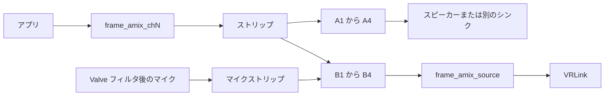

[English](how-it-works.md) · **日本語** · [简体中文](how-it-works.sc.md) · [Deutsch](how-it-works.de.md) · [Français](how-it-works.fr.md) · [Español](how-it-works.es.md) · [Italiano](how-it-works.it.md)

[← README](../README.ja.md)

# しくみ

## マイク

ミックスは、パネルで選んだマイクから始まります。**システムの既定** は既定のソースに従います。**Frame の内蔵マイク** は、Valve のフィルタ（ノイズ抑制、エコー除去、マイク EQ）の後です。これらのフィルタは Frame Mic Tuner が制御します。このアプリは、これらのフィルタもシステムの既定も変えません。

## エンジン

`frame-audio-mixer-engine.service` がグラフを持ちます。パネルを閉じてもミックスは続きます。

- 各チャンネルは `frame_amix_chN` というシンクです。アプリにはチャンネル名（`DJ`）で見えます。
- ストリップはインサート、フェーダー、ミュート、ソロ、メーターを適用し、オンにした A と B のバスへ送ります。
- A1 はヘッドセットのスピーカーです。A2 から A4 は選んだシンクです。
- B1 は `frame_amix_source`（**Frame Mix**）です。B2 から B4 は追加の仮想マイクです。
- マイクストリップの既定の行き先は B1 です。キャプチャは仮想ではないので、Mix がオンのあいだ Valve のノイズ抑制は動いたままです。

チャンネルの追加や削除は、そのチャンネルのノードだけを作ります。PipeWire と WirePlumber は再起動しません。

内部ノードの名前には `virtual` と `sink` の両方が入るので、空間オーディオがミックスをスピーカーへ二重に出しません。

## PC への経路

ミックスがオンのあいだ（`frame-audio-mixer.enabled` が true のとき）、WirePlumber コンポーネント `custom.frame-audio-mixer` が VRLink の録音ストリームを `frame_amix_source` に向けます。既定のメタデータには、そのソースの `object.serial` を書き込みます。そこにノード名を書いても、ストリームは動かないためです。ソースが無い場合、VRLink は通常の既定マイクのままです。マイクを録音するほかのアプリは動かしません。

`frame-audio-mixer.vrlink-gain` の既定値は `1.0` で、この値では VRLink の音量はそのままです。ほかの値はミックスがオンのあいだ適用され、ミックスをオフにすると元の音量に戻ります。

## アプリをチャンネルへ送る

`Frame Mix: <name>` を選んだアプリも空間オーディオを通り、ターゲットとしてノード名を指定しても無視されます。そのため Frame Audio Mixer は、出力の `object.serial` でストリームをチャンネルに固定します。WirePlumber スクリプトとパネルの両方がこれを行います。チャンネルが再起動すると serial が変わり、出力が戻ったときに固定を書き直します。出力が削除されると固定を解除するので、アプリは通常の出力に戻ります。

実行中のアプリから作ったチャンネルは、そのアプリも覚えています。ミックスがオンのあいだは、アプリに出力の設定が無くても、そのストリームをチャンネルに固定します。

このアプリは `wpctl set-default` を呼びません。

## エコー除去

Frame のスピーカーを使うと、マイクがスピーカーの音を拾うことがあります。スピーカーはすでにチャンネルを再生しているので、エコー除去が無いと PC にはアプリの音が二重に届きます。一度はミックスから、もう一度は空気を通して届きます。スピーカーを使うときは、Frame Mic Tuner でエコー除去をオンにしてください。ヘッドホンならこの問題はありません。
