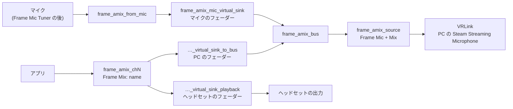

[English](how-it-works.md) · **日本語** · [简体中文](how-it-works.sc.md) · [Deutsch](how-it-works.de.md) · [Français](how-it-works.fr.md) · [Español](how-it-works.es.md) · [Italiano](how-it-works.it.md)

[← README](../README.ja.md)

# しくみ

## マイク

ミックスは、パネルで選んだマイクから始まります。**システムの既定** は既定のソースに従います。Frame では、Valve のフィルタ（ノイズ抑制、エコー除去、マイク EQ）を通った後の内蔵マイクです。これらのフィルタは Frame Mic Tuner が制御します。このアプリは、これらのフィルタもシステムの既定も変えません。

## 中核のグラフ

`frame-audio-mixer-graph.service` が中核を作ります:

- `frame_amix_from_mic` が、選んだマイクを録音します。
- `frame_amix_mic_virtual_sink` はマイクのフェーダーです。`frame_amix_bus` へ再生します。
- `frame_amix_source`（**Frame Mic + Mix**）は、VRLink が録音するソースです。

パネルのマイクのミュートは、`frame_amix_mic_virtual_sink` だけをミュートします。システムのマイクとチャンネルはミュートされません。

## チャンネル

各チャンネルは独立した `frame-audio-mixer-channel@chN.service` で、`ch1` から `ch32` まであります:

- `frame_amix_chN` は、アプリが選ぶ出力です（`Frame Mix: <name>`）。
- `frame_amix_chN_virtual_sink_playback` は、それをヘッドセットで再生します。これがヘッドセットのフェーダーです。
- `frame_amix_chN_virtual_sink_to_bus` は、同じ音をミックスバスへ送ります。これが PC のフェーダーです。

チャンネルを追加または削除すると、起動または停止するのはそのユニットだけです。PipeWire と WirePlumber は動いたままです。

内部の再生ノードの名前には、`virtual` と `sink` の両方が入っています。そのため、SteamOS の空間オーディオがそれらを包み込んで、ミックスをもう一度スピーカーへ送ることはありません。チャンネルの出力は `alsa_output` や `bluez_output` という名前ではないので、Frame Mic Tuner の出力一覧には出ません。

## PC への経路

ミックスがオンのあいだ（`frame-audio-mixer.enabled` が true のとき）、WirePlumber コンポーネント `custom.frame-audio-mixer` が VRLink の録音ストリームを `frame_amix_source` に向けます。既定のメタデータには、そのソースの `object.serial` を書き込みます。そこにノード名を書いても、ストリームは動かないためです。ソースが無い場合、VRLink は通常の既定マイクのままです。マイクを録音するほかのアプリは動かしません。

`frame-audio-mixer.vrlink-gain` の既定値は `1.0` で、この値では VRLink の音量はそのままです。ほかの値はミックスがオンのあいだ適用され、ミックスをオフにすると元の音量に戻ります。

## アプリをチャンネルへ送る

`Frame Mix: <name>` を選んだアプリも空間オーディオを通り、ターゲットとしてノード名を指定しても無視されます。そのため Frame Audio Mixer は、出力の `object.serial` でストリームをチャンネルに固定します。WirePlumber スクリプトとパネルの両方がこれを行います。チャンネルが再起動すると serial が変わり、出力が戻ったときに固定を書き直します。出力が削除されると固定を解除するので、アプリは通常の出力に戻ります。

実行中のアプリから作ったチャンネルは、そのアプリも覚えています。ミックスがオンのあいだは、アプリに出力の設定が無くても、そのストリームをチャンネルに固定します。

このアプリは `wpctl set-default` を呼びません。

## エコー除去

Frame のスピーカーを使うと、マイクがスピーカーの音を拾うことがあります。スピーカーはすでにチャンネルを再生しているので、エコー除去が無いと PC にはアプリの音が二重に届きます。一度はミックスから、もう一度は空気を通して届きます。スピーカーを使うときは、Frame Mic Tuner でエコー除去をオンにしてください。ヘッドホンならこの問題はありません。
