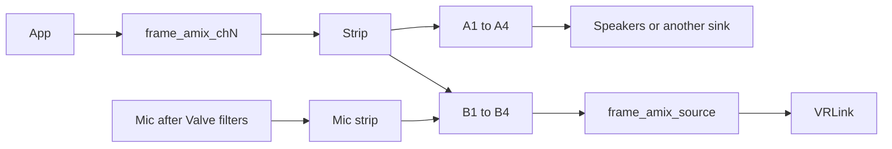

**English** · [日本語](how-it-works.ja.md) · [简体中文](how-it-works.sc.md) · [Deutsch](how-it-works.de.md) · [Français](how-it-works.fr.md) · [Español](how-it-works.es.md) · [Italiano](how-it-works.it.md)

[← README](../README.md)

# How it works

## The microphone

The mix starts with the microphone you chose in the panel. **System default** follows the default source. **Frame built-in mic** is the microphone after Valve's filters (noise suppression, echo cancellation and the mic EQ), which Frame Mic Tuner controls. This app never changes those filters and never changes the system default.

## The engine

`frame-audio-mixer-engine.service` owns the graph. The mix keeps running when the panel closes.

- Each channel is a sink named `frame_amix_chN`. Apps see it by the channel name (`DJ`).
- The strip applies inserts, the fader, mute, solo and the meter, then routes to the A and B buses you turned on.
- A1 plays on the headset speakers. A2–A4 play on the sink you pick.
- B1 is `frame_amix_source` (**Frame Mix**). B2–B4 are more virtual microphones.
- The microphone strip defaults to B1. Its capture is not virtual, so Valve's noise suppression stays on while Mix is on.

Adding or removing a channel only creates or destroys that channel's nodes. PipeWire and WirePlumber keep running.

Internal node names contain both `virtual` and `sink`, so SteamOS spatial audio does not wrap them and play the mix on the speakers a second time. Channel sinks are not named `alsa_output` or `bluez_output`, so they stay out of Frame Mic Tuner's output list.

## Routing to the PC

While Mix is on (`frame-audio-mixer.enabled` is true), the WirePlumber component `custom.frame-audio-mixer` points the VRLink capture stream at `frame_amix_source`. The same switch is in App settings. Turning it off leaves the channel outputs and Frame Mix in place. It writes that source's `object.serial` into the default metadata, because a node name there does not move the stream. If the source is missing, VRLink keeps the normal default microphone.

`frame-audio-mixer.vrlink-gain` defaults to `1.0`, which leaves VRLink's volume as it is.

## Routing apps to channels

An app that chooses a channel by name still goes through spatial audio, and a node name as its target is ignored. The panel pins the stream by the output's `object.serial`. The serial changes when a channel restarts, and the pin is written again when the output comes back.

Nothing in this app calls `wpctl set-default`.

## Mix Check

Mix Check records B1 inside the engine, up to 10 seconds, and plays it on A1. While it records or plays, the microphone is held out of the mix and headset effect returns are muted, so the take is not monitored and cannot feed back.

## Effects

Each strip has inserts. The equalizer is parametric: 3, 6, 8 or 12 points, with a response curve. The first and last points can be a bell, a shelf, a high-pass or a low-pass. FX1 and FX2 are shared sends. A send is a copy; the dry routes stay. Each return has a fader and the same A/B buttons as a strip.

## Echo cancellation

With the Frame's speakers, the microphone can hear the speakers. The speakers already play the channels, so without echo cancellation the PC hears the app audio twice: once from the mix and once through the air. Turn echo cancellation on in Frame Mic Tuner when you use the speakers. Headphones do not have this problem.
