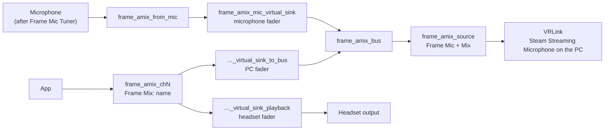

**English** · [日本語](how-it-works.ja.md) · [简体中文](how-it-works.sc.md) · [Deutsch](how-it-works.de.md) · [Français](how-it-works.fr.md) · [Español](how-it-works.es.md) · [Italiano](how-it-works.it.md)

[← README](../README.md)

# How it works

## The microphone

The mix starts with the microphone you chose in the panel. **System default** follows the default source. On the Frame that is the built-in microphone after Valve's filters (noise suppression, echo cancellation and the mic EQ), which Frame Mic Tuner controls. This app never changes those filters and never changes the system default.

## The core graph

`frame-audio-mixer-graph.service` builds the core:

- `frame_amix_from_mic` records the chosen microphone.
- `frame_amix_mic_virtual_sink` is the microphone fader. It plays into `frame_amix_bus`.
- `frame_amix_source` (**Frame Mic + Mix**) is the source that VRLink records.

The microphone mute in the panel mutes `frame_amix_mic_virtual_sink` only. The system microphone and the channels are not muted.

## Channels

Each channel is its own `frame-audio-mixer-channel@chN.service`, from `ch1` to `ch32`:

- `frame_amix_chN` is the output that apps select (`Frame Mix: <name>`).
- `frame_amix_chN_virtual_sink_playback` plays it in the headset. This is the headset fader.
- `frame_amix_chN_virtual_sink_to_bus` sends the same audio into the mix bus. This is the PC fader.

Adding or removing a channel starts or stops only that unit. PipeWire and WirePlumber keep running.

The internal playback names contain both `virtual` and `sink`. Because of that, SteamOS's spatial audio does not wrap them and send the mix to the speakers a second time. Channel outputs are not named `alsa_output` or `bluez_output`, so they stay out of Frame Mic Tuner's output list.

## Routing to the PC

While Mix is on (`frame-audio-mixer.enabled` is true), the WirePlumber component `custom.frame-audio-mixer` points the VRLink capture stream at `frame_amix_source`. It writes that source's `object.serial` into the default metadata, because a node name there does not move the stream. If the source is missing, VRLink keeps the normal default microphone. Other apps that record the microphone are not moved.

`frame-audio-mixer.vrlink-gain` defaults to `1.0`, which leaves VRLink's volume as it is. Any other value is applied while Mix is on, and the previous volume comes back when Mix turns off.

## Routing apps to channels

An app that chooses `Frame Mix: <name>` still goes through spatial audio, and a node name as its target is ignored. So Frame Audio Mixer pins the stream to the channel by the output's `object.serial`. The WirePlumber script and the panel both do this. The serial changes when a channel restarts, and the pin is written again when the output comes back. When an output is removed, the pin is cleared so the app falls back to the normal output.

A channel made from a running app also remembers that app. While Mix is on, its streams are pinned to the channel even when the app has no output setting.

Nothing in this app calls `wpctl set-default`.

## Echo cancellation

With the Frame's speakers, the microphone can hear the speakers. The speakers already play the channels, so without echo cancellation the PC hears the app audio twice: once from the mix and once through the air. Turn echo cancellation on in Frame Mic Tuner when you use the speakers. Headphones do not have this problem.
