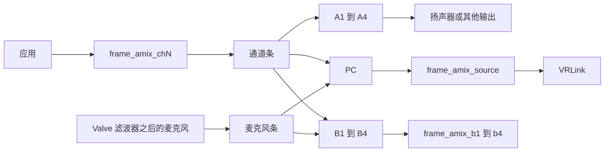

[English](how-it-works.md) · [日本語](how-it-works.ja.md) · **简体中文** · [Deutsch](how-it-works.de.md) · [Français](how-it-works.fr.md) · [Español](how-it-works.es.md) · [Italiano](how-it-works.it.md)

[← README](../README.sc.md)

# 工作方式

## 麦克风

混音从面板里选择的麦克风开始。**系统默认**跟随默认源。**Frame 麦克风**是经过 Valve 滤波器之后的内置麦克风。这些滤波器由 Frame Mic Tuner 控制。本应用不改动它们，也不改变系统默认。

## 引擎

`frame-audio-mixer-engine.service` 持有整张图。面板关闭后混音继续。

- 每个通道是一个名为 `frame_amix_chN` 的 sink。应用看到的是通道名（`DJ`）。
- 通道条应用推子、静音、独奏和电平，然后送到你用推子旁边的按钮打开的输出。
- A1 是头显扬声器。A2 到 A4 是你选择的输出。
- PC（显示器加扬声器图标）是 `frame_amix_source`（**Frame Mix**），也就是 PC 听到的麦克风。它是一个独立的输出，在 2、4、6 或 8 个 A 和 B 输出之外另外存在。
- B1 到 B4 是给头显上其他应用用的更多虚拟麦克风（`frame_amix_b1` 到 `frame_amix_b4`）。
- 麦克风条默认只送到 PC。采集端不是虚拟节点，所以 Mix 打开时 Valve 的噪声抑制保持开启。

添加或删除通道只创建或销毁该通道的节点。PipeWire 和 WirePlumber 不会重启。

内部节点名同时包含 `virtual` 和 `sink`，所以空间音频不会把混音再送到扬声器。

## 路由到 PC

混音打开时（`frame-audio-mixer.enabled` 为 true），WirePlumber 组件 `custom.frame-audio-mixer` 会把 VRLink 的采集流指向 `frame_amix_source`。它把这个源的 `object.serial` 写入默认元数据，因为在那里写节点名不会移动这条流。如果源不存在，VRLink 继续使用原来的默认麦克风。其他录制麦克风的应用不会被移动。

`frame-audio-mixer.vrlink-gain` 默认是 `1.0`，这样 VRLink 的音量保持不变。其他值在混音打开时生效，关闭混音后会恢复之前的音量。

## 把应用路由到通道

选择了 `Frame Mix: <name>` 的应用仍会经过空间音频，并且把节点名设为目标会被忽略。所以 Frame Audio Mixer 用输出的 `object.serial` 把流固定到通道。WirePlumber 脚本和面板都会这样做。通道重启后 serial 会变，输出重新出现时会再写一次固定。删除输出时会清除固定，应用就回到普通输出。

用正在运行的应用创建的通道还会记住那个应用。混音打开时，即使那个应用没有输出设置，它的流也会被固定到这个通道。

本应用不会调用 `wpctl set-default`。

## 混音检查

混音检查位于输出抽屉顶部。选择一个输出（PC、A 或 B），按录制，引擎最多录制 10 秒。播放和暂停会在 A1 上播放这一段录音；新的录音会替换它。录制或播放期间，麦克风不进入混音，头显的效果返回被静音，所以录音不会被监听，也不会产生回授。

## 效果

效果位于 FX1 和 FX2 上，它们是共享发送，每个通道条都可以在推子旁边打开。每条链最多放三个效果。均衡器是其中之一：参量均衡，3、6、8 或 12 个点，带响应曲线。它的编辑按钮会打开完整的均衡界面。第一个和最后一个点可以是钟形、搁架、高通或低通。发送是一份副本，干声路由保持不变。每个返回都有一个推子，以及和通道条一样的 A、PC 和 B 按钮。

## 回声消除

使用 Frame 的扬声器时，麦克风会听到扬声器。扬声器已经在播放各个通道，所以没有回声消除时，PC 会听到两遍应用的声音：一遍来自混音，一遍经空气传到麦克风。使用扬声器时，请在 Frame Mic Tuner 里打开回声消除。耳机没有这个问题。
