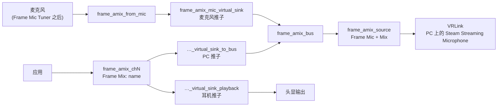

[English](how-it-works.md) · [日本語](how-it-works.ja.md) · **简体中文** · [Deutsch](how-it-works.de.md) · [Français](how-it-works.fr.md) · [Español](how-it-works.es.md) · [Italiano](how-it-works.it.md)

[← README](../README.sc.md)

# 工作方式

## 麦克风

混音从你在面板里选择的麦克风开始。**系统默认** 跟随默认源。在 Frame 上，这就是经过 Valve 滤波器（噪声抑制、回声消除和麦克风 EQ）之后的内置麦克风，这些滤波器由 Frame Mic Tuner 控制。本应用从不改动这些滤波器，也从不改变系统默认。

## 核心音频图

`frame-audio-mixer-graph.service` 建立核心：

- `frame_amix_from_mic` 采集所选的麦克风。
- `frame_amix_mic_virtual_sink` 是麦克风推子。它送入 `frame_amix_bus`。
- `frame_amix_source`（**Frame Mic + Mix**）是 VRLink 录制的源。

面板里的麦克风静音只静音 `frame_amix_mic_virtual_sink`。系统麦克风和各个通道不会被静音。

## 通道

每个通道都是自己的 `frame-audio-mixer-channel@chN.service`，从 `ch1` 到 `ch32`：

- `frame_amix_chN` 是应用选择的输出（`Frame Mix: <name>`）。
- `frame_amix_chN_virtual_sink_playback` 把它播放到头显。这是耳机推子。
- `frame_amix_chN_virtual_sink_to_bus` 把同样的声音送进混音总线。这是 PC 推子。

添加或删除通道时，只启动或停止那一个单元。PipeWire 和 WirePlumber 保持运行。

内部播放节点的名字同时包含 `virtual` 和 `sink`。因此 SteamOS 的空间音频不会把它们包起来，再把混音送一次到扬声器。通道输出不叫 `alsa_output` 或 `bluez_output`，所以不会出现在 Frame Mic Tuner 的输出列表里。

## 路由到 PC

混音打开时（`frame-audio-mixer.enabled` 为 true），WirePlumber 组件 `custom.frame-audio-mixer` 会把 VRLink 的采集流指向 `frame_amix_source`。它把这个源的 `object.serial` 写入默认元数据，因为在那里写节点名不会移动这条流。如果源不存在，VRLink 继续使用原来的默认麦克风。其他录制麦克风的应用不会被移动。

`frame-audio-mixer.vrlink-gain` 默认是 `1.0`，这样 VRLink 的音量保持不变。其他值在混音打开时生效，关闭混音后会恢复之前的音量。

## 把应用路由到通道

选择了 `Frame Mix: <name>` 的应用仍会经过空间音频，并且把节点名设为目标会被忽略。所以 Frame Audio Mixer 用输出的 `object.serial` 把流固定到通道。WirePlumber 脚本和面板都会这样做。通道重启后 serial 会变，输出重新出现时会再写一次固定。删除输出时会清除固定，应用就回到普通输出。

用正在运行的应用创建的通道还会记住那个应用。混音打开时，即使那个应用没有输出设置，它的流也会被固定到这个通道。

本应用不会调用 `wpctl set-default`。

## 回声消除

使用 Frame 的扬声器时，麦克风会听到扬声器。扬声器已经在播放各个通道，所以没有回声消除时，PC 会听到两遍应用的声音：一遍来自混音，一遍经空气传到麦克风。使用扬声器时，请在 Frame Mic Tuner 里打开回声消除。耳机没有这个问题。
