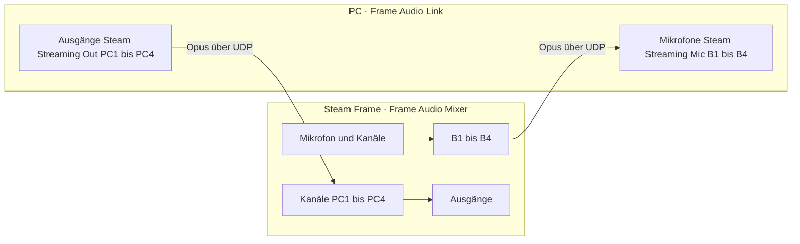

[English](pc-link.md) · **Deutsch**

[← README](../README.de.md)

# PC-Audio-Link

**Frame Audio Link** ist ein Add-on für SteamVR am PC. Damit gilt:

- Die virtuellen Mikrofone **B1–B4** des Mixers sind auch vier Mikrofone am PC, neben dem Steam Streaming Microphone.
- Vier PC-Ausgänge, **PC1–PC4**, lassen sich im Mixer als Kanäle hinzufügen.

Das normale Streaming-Mikrofon am PC arbeitet weiter wie bisher. Der Link ist eine zweite Verbindung daneben.



## Am PC installieren

Wie das Add-on und seine acht Audiogeräte unter Windows und Linux installiert werden, steht unter [Am PC installieren](install-pc.de.md).

## Benutzen

- **Vom Headset zum PC.** Im Mixer das Mikrofon oder einen Kanal mit den Routing-Tasten auf B1–B4 legen. Am PC in einer beliebigen App **Steam Streaming Mic B1** … **B4** als Mikrofon wählen. Ein Name, den ein B-Ausgang im Mixer bekommt, erscheint im Overlay am PC.
- **Vom PC zum Headset.** Am PC eine App auf **Steam Streaming Out PC1** … **PC4** ausgeben lassen. Im Mixer **+** drücken und **PC1** … **PC4** wählen. Der neue Kanal hat Fader, Mute, Routing und Effekte wie jeder andere.
- **Streams abschalten.** Im SteamVR-Dashboard **Audio Link** öffnen. Jedes Mikrofon und jeder Ausgang hat einen eigenen Schalter. Ein ausgeschalteter Stream belegt keine Bandbreite.
- **Im Mixer sehen.** Solange ein PC verbunden ist, zeigen jeder B-Ausgang und jeder PC-Kanal das PC-Symbol. Es ist durchgestrichen, wenn dieser Stream am PC ausgeschaltet ist, bei einem PC-Kanal auch dann, wenn kein PC verbunden ist.
- **Sprache des Overlays ändern.** Das Overlay startet in der Sprache des PCs. Die Sprachtaste neben dem Titel bietet die sieben Sprachen des Mixers: English, 日本語, 简体中文, Deutsch, Français, Español und Italiano.
- **Den Link abschalten** geht am Headset unter **App-Einstellungen → PC-Audio-Link**.

## Verhalten

- **Qualität.** Jeder Stream ist Stereo, 48 kHz, Opus mit 128 kbit/s in 10-ms-Frames. Opus verwendet auch das normale Streaming-Mikrofon.
- **Bandbreite.** Ein Stream wird nur gesendet, solange beide Seiten ihn wollen und er Ton führt. Stille kostet nichts. Ein aktiver Stream braucht etwa 0,3 Mbit/s, weil jeder Frame zweimal gesendet wird, damit ein einzelnes verlorenes Paket nicht zu hören ist.
- **Verzögerung.** Etwa 60 ms von Audiogerät zu Audiogerät bei guter Verbindung. Der Empfänger puffert 20 ms, nach einem Aussetzer des Netzes bis zu 120 ms, und gibt den Zuschlag wieder ab, wenn das Netz eine Weile ruhig war.
- **Takt.** Die Audiogeräte von PC und Headset laufen minimal verschieden schnell. Der Empfänger folgt dem Sender, indem er um Bruchteile eines Prozents umrechnet. Es wird nie ein Frame verworfen oder wiederholt, um Schritt zu halten.
- **Wer sich verbinden darf.** Das Headset antwortet nur dem PC, von dem es gerade VR streamt, und nur einem PC zugleich. Andere Geräte im Netz werden abgewiesen. Der Ton ist unterwegs nicht verschlüsselt; er bleibt im lokalen Netz.
- **Netz.** UDP-Port 47811 am Headset. Der PC findet das Headset selbst und nimmt bei zwei Wegen den schnelleren (den direkten Funkadapter oder das Heimnetz).
- **Last am Headset.** Führen alle acht Streams gleichzeitig Musik, braucht das Kodieren etwa 15 % eines seiner acht Kerne. Ausgeschaltete oder stille Streams kosten nichts.

## Andere virtuelle Kabel unter Windows

Für ein anderes virtuelles Kabel (VB-CABLE und ähnliche) mit `install.cmd -NoDevices` installieren und die Geräte in `%APPDATA%\frame-audio-link\config.json` eintragen:

- `mic_devices`: für B1–B4 jeweils das Aufnahmegerät, das Apps auswählen, oder das Wiedergabegerät, das es speist, wenn die beiden Enden des Kabels getrennte Geräte sind.
- `output_devices`: für PC1–PC4 jeweils das Wiedergabegerät, das gesendet wird.

Ein Gerät wird verwendet, wenn sein Name mit dem Eintrag beginnt.

## Wenn etwas nicht stimmt

- Das Overlay sagt, was fehlt: kein Headset gefunden, das Headset hat abgelehnt (es ist mit einem anderen PC verbunden, es streamt nicht von diesem PC, oder beide Seiten brauchen ein Update), oder ein Audiogerät ist nicht installiert.
- `frame-audio-link status` in einem Terminal zeigt zehn Sekunden lang Link und Geräte. `frame-audio-link devices status` (Windows) listet die acht Geräte auf.
- Das Protokoll liegt unter Windows in `%APPDATA%\frame-audio-link\frame-audio-link.log`, unter Linux in `~/.config/frame-audio-link/frame-audio-link.log`.

## Deinstallieren

Windows: `uninstall.cmd` aus dem Archiv doppelklicken (entfernt die acht Geräte, den SteamVR-Eintrag und das Programm). Linux: `~/.local/bin/frame-audio-link uninstall` ausführen und danach `~/.local/bin/frame-audio-link` löschen, oder `install-linux.sh --uninstall` aus dem Archiv starten.

## Bauen

`link/core` ist der Link selbst (Protokoll, Codec, Jitter-Puffer), gemeinsam für Mixer und Add-on. `link/addon` ist das Add-on.

```sh
cd link/core  && cargo test
cd link/addon && cargo test && cargo build --release
```

`link/addon/scripts/package-windows.ps1` und `package-linux.sh` schreiben die Release-Archive und `SHA256SUMS` nach `link/addon/dist/`. `cargo run --release --example peer` in `link/core` ersetzt die Gegenseite, um eine Seite allein zu testen.
