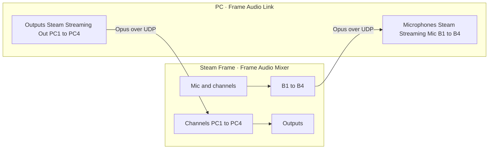

**English** · [Deutsch](pc-link.de.md)

[← README](../README.md)

# PC audio link

**Frame Audio Link** is an add-on for SteamVR on the PC. With it:

- the mixer's virtual microphones **B1–B4** are also four microphones on the PC, next to the Steam Streaming Microphone,
- four PC outputs, **PC1–PC4**, can be added to the mixer as channels.

The stock PC streaming microphone keeps working as before. The link is a second connection beside it.



## Install on the PC

How to install the add-on and its eight sound devices on Windows and Linux is in [Install on the PC](install-pc.md).

## Use it

- **Headset to PC.** In the mixer, route the microphone or a channel to B1–B4 with the route buttons. On the PC, pick **Steam Streaming Mic B1** … **B4** as the microphone in any app. A name you give a B output in the mixer shows in the overlay on the PC.
- **PC to headset.** On the PC, let an app play on **Steam Streaming Out PC1** … **PC4**. In the mixer, press **+** and pick **PC1** … **PC4**. The new channel has a fader, mute, routes and effects like any other.
- **Switch streams off.** Open **Audio Link** in the SteamVR dashboard. Every microphone and output has its own switch. A stream that is off uses no network bandwidth.
- **See it in the mixer.** While a PC is linked, each B output and each PC channel shows the PC icon. The icon is struck through when that stream is switched off on the PC, or, for a PC channel, when no PC is linked.
- **Change the overlay's language.** The overlay starts in the PC's language. The language button next to its title offers the mixer's seven: English, 日本語, 简体中文, Deutsch, Français, Español and Italiano.
- **Switch the link off** on the headset in **App settings → PC audio link**.

## How it behaves

- **Quality.** Every stream is stereo, 48 kHz, Opus at 128 kbit/s in 10 ms frames. Opus is also what the stock streaming microphone uses.
- **Bandwidth.** A stream is sent only while both ends want it and it carries sound. Silence costs nothing. An active stream takes about 0.3 Mbit/s, because every frame is sent twice so that a single lost packet is not heard.
- **Delay.** Around 60 ms from one sound device to the other on a good link. The receiving end buffers 20 ms, and up to 120 ms after the network stalled; it gives the extra back once the network has been steady for a while.
- **Clocks.** The PC's and the headset's sound devices run at slightly different speeds. The receiver follows the sender by resampling by a fraction of a percent, so no frame is ever dropped or repeated to keep up.
- **Who may connect.** The headset only answers the PC it is streaming VR from, and one PC at a time. Other devices on the network are refused. The audio is not encrypted on its way; it stays on your local network.
- **Network.** UDP port 47811 on the headset. The PC finds the headset by itself and uses the faster path when there are two (the direct wireless adapter or the home network).
- **Cost on the headset.** With all eight streams carrying music at once, coding takes about 15 % of one of its eight cores. Streams that are off or silent cost nothing.

## Other virtual cables on Windows

To use another virtual cable (VB-CABLE and the like) for a stream, install with `install.cmd -NoDevices` and name the devices in `%APPDATA%\frame-audio-link\config.json`:

- `mic_devices`: for each of B1–B4, the recording device apps pick, or the playback device that feeds it when the two ends of the cable are separate devices.
- `output_devices`: for each of PC1–PC4, the playback device to send.

A device is used when its name starts with the entry.

## When something is off

- The overlay says what is missing: no headset found, the headset refused (it is linked to another PC, it is not streaming from this PC, or the two ends need an update), or a sound device is not installed.
- `frame-audio-link status` in a terminal prints the link and the devices for ten seconds. `frame-audio-link devices status` (Windows) lists the eight devices.
- The log is `%APPDATA%\frame-audio-link\frame-audio-link.log` on Windows and `~/.config/frame-audio-link/frame-audio-link.log` on Linux.

## Uninstall

Windows: double-click `uninstall.cmd` from the archive (it removes the eight devices, the SteamVR entry and the program). Linux: `~/.local/bin/frame-audio-link uninstall`, then delete `~/.local/bin/frame-audio-link`, or run `install-linux.sh --uninstall` from the archive.

## Build

`link/core` is the link itself (protocol, codec, jitter buffer), shared by the mixer and the add-on. `link/addon` is the add-on.

```sh
cd link/core  && cargo test
cd link/addon && cargo test && cargo build --release
```

`link/addon/scripts/package-windows.ps1` and `package-linux.sh` write the release archives and `SHA256SUMS` into `link/addon/dist/`. `cargo run --release --example peer` in `link/core` is a stand-in for the other end, for testing one end by itself.
